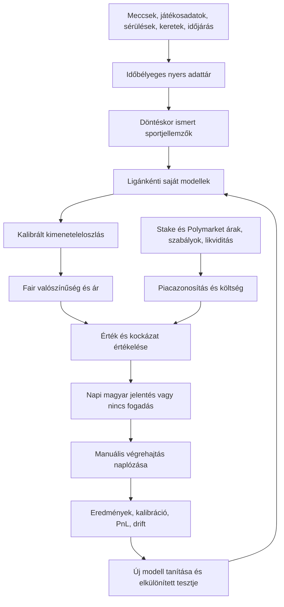

# Rendszerterv — kutatási változat, 2026-09-27

**Történeti dokumentum.** A könyvolvasás előtt készült prototípus terve; nem a jelenlegi elfogadott architektúra. A napi legalább tíz jelöltre vonatkozó új felhasználói célt és a fejlesztési sorrendet a [részletes menetrend](MENETREND.hu.md) rögzíti. Az alábbi régi működési szabályok nem írják felül az új követelményt.

Ez előzetes terv. A könyvek hozzáférése és részletes feldolgozása után
forrásonként felülvizsgálandó. A tervben szereplő komponensek többsége még
nincs implementálva; a README a ténylegesen futtatható részeket sorolja fel.

## 1. Termék és alapelv

Öt liga, kezdetben mérkőzés előtti moneyline, majd spread és total.
Napi magyar jelentés Europe/Budapest időzónában; automatikus fogadásleadás
nélkül. Tippenként legfeljebb 5 USD teljes kockázat, alsó határ 1 USD:
ha a megfelelő tét ennél kisebb, kihagyjuk. Nem kötelező minden nap fogadni.

A bookmaker szemlélet a kimenetelek eloszlásának becslését, saját fair árazást,
információfrissítést és összesített kockázatkezelést jelenti. Egy bookmaker
haszna és kitettsége eltér a fogadóétól: a margin és az ügyféláramlás nem a
saját valószínűségi modell helyettesítője.

## 2. Adatfolyam és komponenshatár

Az odds és a bookmaker spread NEM kerül a sportmodell feature táblájába.
A modell a pontkülönbség és összpontszám eloszlását önállóan becsüli; egy
kiírt spread csak utólag adja meg, az eloszlás mely tartományát árazzuk.
Külön piaci benchmark készülhet diagnosztikára, de nem módosíthatja
észrevétlenül a független modell valószínűségeit.

## 3. Tudásbázis

Könyvenként bibliográfia, tartalomjegyzék, fejezeti összefoglaló, oldalszám,
képletek és feltételezéseik, sportági alkalmazás, ellenpéldák, megvalósítási
követelmények. Minden szabály kap forrást és tesztelhető hipotézist.
Elkülönítjük: szerző állítása, matematikai levezetés, empirikus eredmény,
saját következtetés. A könyvek egymásnak ellentmondó állításait megőrizzük.
A modell egy könyv tekintélyétől nem kap igazolt előnyt.

Kereshető SQLite FTS index az első lépcső. Embedding/RAG csak akkor kerül
mellé, ha az oldalszintű visszakereséshez szükséges; egy kis személyes
könyvtárhoz nem kell külön vektoradatbázis-szolgáltatás.

## 4. Saját sportmodellek — tervezett kutatási irányok

| Liga | Alapmodell és további modell | Elsődleges saját adatok | Speciális kockázat |
|---|---|---|---|
| NBA | Csapaterősség-baseline; possession alapú támadó/védő modell, közös score-szimuláció | Ellenfélerősséggel korrigált hatékonyság, pace, várható játékpercek, sérülés, pihenés, utazás | Kezdők és játékpercek bizonytalansága; overtime |
| WNBA | Külön hierarchikus modell, NBA-paraméterek automatikus átvétele nélkül | Rotációk, játékoselérhetőség, pace, csapatszintű hatékonyság | Kis minta, csapat- és keretváltozások |
| MLB | Kezdődobó + lineup + bullpen futásmodell; túlzott szórás vizsgálata | Dobó/ütő matchup, platoon, park, időjárás, bullpen terhelés | Kezdődobócsere, doubleheader, halasztás, extra inning |
| NHL | Lövésminőség/xG alapú gólmodell, közös szimuláció | Várható kapus, special teams, 5v5 teljesítmény, pihenés | Rendes játékidő vs hosszabbítás/szétlövés, empty net |
| NFL | Drive/ponteloszlás, hierarchikus erősség; diszkrét score-szimuláció | QB, sérülések, play-by-play hatékonyság, pace, időjárás, matchup | Kevés mérkőzés, kulcsszámok, döntetlen, overtime |

A Poisson/negatív binomiális/Normális eloszlás jelölt, nem előre igazolt
igazság. A farokeloszlást, pontkorrelációt és kalibrációt külön teszteljük.
NFL-ben a 3/7 körüli score-tömeg, egész spreadnél a push valószínűsége
nem veszhet el egy egyszerű folytonos közelítésben.

Az első MVP egy ligán és egy piacon bizonyít. Az öt liga csatlakozóit
egységes szerződés fogadja, de mindegyik modell külön validációt kap.
A liga kiválasztása a könyvek és a tényleges adatlefedettség alapján történik.

## 5. Adatszerződések

- `events`: kanonikus event_id, liga, hazai/vendég team_id, kezdés UTC,
  helyszín, neutral_site, státusz, provider azonosítók, szabályverzió.
- `facts`: entity_id, adatérték és mértékegység, forrás, occurred_at,
  published_at/known_at, ingested_at, revision_id. A javítás új rekord.
- `features`: event_id, as_of, feature_schema_version, input snapshot hash.
  Csak az `as_of` előtt ismert rekordok használhatók.
- `predictions`: event_id, model_version, generated_at, sportadat cutoff,
  score-eloszlás vagy win/push/lose, bizonytalanság módszere, input hash.
- `markets`: venue és market_id, outcome/token ID, event_id, market_type,
  oldal, line, időszak, overtime-kezelés, halasztás/push/void szabály.
- `quotes`: source_at és received_at, bid/ask vagy decimal odds,
  depth, minimum méret, fee-paraméterek, felfüggesztési státusz.
- `recommendations`: prediction és quote ID, indok, lejárat, minimum odds
  vagy maximum all-in tokenár, kockázati keret lefoglalása, verzió.
- `executions`: a felhasználó tényleges tétje/ára/időpontja. A kiküldött
  ajánlás nem egyenlő a megkötött fogadással.
- `settlements`: win/loss/push/void, tényleges kifizetés, díj, forrás,
  elszámolási idő, esetleges utólagos korrekció.

MLB doubleheaderhez nem elég a két csapat és a nap. Minden piacillesztés
eseményazonosítót és kezdést használ; bizonytalan illesztésnél kihagyás.

## 6. Matematikai döntés

Sportbook, díj nélkül: `EV = p_win * (decimal_odds - 1) - p_lose`.
A push nyeresége nulla. A fair decimal ár `1 + p_lose / p_win`;
a `1/p_win` csak push nélküli bináris esetben helyes.

Token, bináris 1 USD kifizetéssel: `EV / capital = p_win / all_in_cost - 1`.
Az all-in költség az adott méretre számolt tényleges ask/VWAP + díj;
középár és utolsó kötés nem bizonyít végrehajtható vételi árat. A token
érvénytelenítésének kifizetése külön szabály; nem sportsbook pushként kezeljük.

Tétezés: az ismert kimenetelekre `E[log(1 + f * net_return)]` maximalizálása,
ennek konzervatív része és további korlátok. Kezdeti kutatási beállítás:
negyed Kelly, maximum bankroll 1%-a/fogadás, legfeljebb 5 USD. Ezek nem
személyre szabott, végleges kockázati limitek; bankroll nélkül nincs éles tét.

Egy egyszerű valószínűségi levonás érzékenységvizsgálat, nem 95%-os
konfidenciaintervallum. Az éles bizonytalanságot időblokkonkénti bootstrap,
modellensemble és külön kalibrációs minta alapján kell vizsgálni.

A napi tétkeret és az egy mérkőzéshez tartozó korrelált kitettség a naplóban
tranzakciósan foglalódik. Ugyanazon meccs moneyline és spread tippei nem
számítanak független fogadásoknak. Kezdetben legfeljebb egy tipp/esemény.

## 7. Napi ciklus — tervezett működés

1. Függő napok eredményeinek és a tényleges fogadások elszámolásának frissítése.
2. Előző 24 óra adatminőségi, előrejelzési és pénzügyi riportja.
3. Következő budapesti jelentési időszak eseményei, sportadatok frissítése.
4. Játékos/kezdő bizonytalanság kezelése; hiányzó kritikus adatnál kihagyás.
5. Független modellek becslése, verziózott és reprodukálható mentés.
6. Piaci eseményazonosítás, szabályok, friss árak, díjak, likviditás ellenőrzése.
7. Költségek utáni előny és kockázat szűrése; jelentés minden esetben.
8. A megadott jelentési csatornára deduplikált küldés, kézbesítési napló.
9. Indulás előtt újraellenőrzés; megváltozott kezdő/ár esetén módosítás
   vagy visszavonás. Már leadott fogadásról nem feltételezünk visszavonhatóságot.

Az ütemezés kezdetben egy helyi Python folyamat és SQLite WAL, később
szükség esetén mindig bekapcsolt VPS. Alvó vagy kikapcsolt Mac nem megbízható
24/7 gazda. Telepített ütemező hiányában ez a chat nem futtat napi háttérmunkát.

Futásonként lock, idempotenciakulcs, API timeout, exponenciális retry csak
átmeneti hibákra, kvótakeret, hiányos feednél hibaüzenet és nulla új tipp.
A régi ár nem válik frissé attól, hogy később letöltöttük.

## 8. Visszateszt, validáció és önfejlesztés

Időrendi train → validation → calibration → érintetlen test blokkok.
Sem véletlen train/test keverés, sem záróár a korábbi döntés bemeneteként.
Újraválasztott paraméterekhez belső időrendi keresés; az outer testet nem
használjuk döntési küszöb finomítására. Azonos meccs sorai egy blokkban.
Sérülések/kezdők historikus ismertségi ideje kell, nem az utólag javított állapot.

Mérőszámok: log loss, Brier, kalibrációs ábra és mintaszám, piaconkénti
EV/ROI, darabszám, turnover, díjak, maximum drawdown, bizonytalansági sáv,
no-bet arány, adathiány. A hit rate önmagában nem nyereségmutató.
CLV csak azonos szabályú/line-ú piac és marginmentesített záróbenchmark
esetén értelmezhető; pozitív CLV sem bizonyít önmagában profitot.

Tanuló ciklus: naponta új adat és diagnosztika; elegendő új minta után
jelölt modell tanítása, lezárt teszt, shadow összehasonlítás az aktív modellel.
Csere csak előre rögzített pontossági, kalibrációs, kockázati és adatminőségi
feltételek mellett; az aktív modell és rollback verzió megmarad.
Egyetlen elvesztett fogadás nem ok a modell átírására. Önmódosító kód helyett
verziózott, tesztelt tanítási pipeline. A kezdeti kiadásokhoz nincs automatikus
modellpromóció, amíg a küszöbök nincsenek empirikusan megalapozva.

Az LLM könyvekből/hírekből forrásolt tényeket strukturálhat és magyarázatot
írhat. Nem talál ki sérülést, nem pótol numerikus modellel nem becsült
valószínűséget, és nem írhatja felül a téthatárokat.

## 9. Napi jelentés formája

Státusz: adat rendben / részleges / nincs fogadás / szolgáltatási hiba.
Minden tipp: liga, esemény és budapesti kezdés; pontos piac és elszámolási
szabály; platform; saját valószínűség és bizonytalanság; elérhető ár és
időbélyeg; minimum elfogadható odds/max. tokenár; nettó EV; 1–5 USD teljes
kockázat; rövid adatvezérelt indok; kritikus feltétel és lejárat.
A nap végén ajánlott vs ténylegesen megkötött fogadások külön kimutatásban.

## 10. Elfogadási kapuk és megvalósítási sorrend

1. **Könyvek**: teljes leltár, minden oldal olvashatósága és minden fejezet
   ellenőrzött feldolgozása; OCR/hiányzó oldalak külön jelölve.
2. **Adat**: kiválasztott liga historikus és aktuális feedje, stabil ID-k,
   ismertségi idő, kezdők, ár/fee/szabály; lefedettségi és kvótamérés.
3. **Baseline**: odds nélküli saját sportmodell, időrendi értékelés,
   reprodukálható artifacts és train cutoff. Nem pusztán Elo a kész termék.
4. **Árazás és napló**: esemény/market összerendelés, all-in költség,
   min. méret, frissesség, kitettség, elszámolás, ismétlés elleni védelem.
5. **Paper működés**: napi jelentés valódi árakkal és modellel, pénz nélkül;
   a mintanagyság és konfidenciasáv dönt a továbblépésről, nem néhány nyertes nap.
6. **Manuális éles tippek**: ismert bankroll, végrehajtható feed, teljes
   költségkalkuláció, értesítési csatorna és számszerűen értékelt modell.
7. **További ligák és piacok**: liga/market saját tesztek után.

Még tisztázandó: bankroll és napi veszteség/kitettségi limit, csatorna,
adat-előfizetési keret, napi időpont, futtatási hely. Az API-k előfizetési
költségét is le kell vonni az üzleti eredményből: 1–5 dolláros téteknél
ez könnyen meghaladhatja a várható fogadási profitot.
