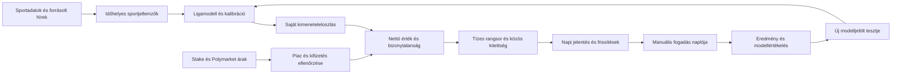

> **Történeti terv.** A napi 10 jelölt, a korábbi keret és a régi fázisok már nem az aktuális követelmények. A 2026-09-29-i [készültségi és felügyelt fejlesztési terv](READINESS.hu.md), valamint a `config/project_contract.json` az irányadó.

> **2026-09-28-i megvalósítási frissítés:** a helyi kutatási kiadás fut, 48 órás horizonttal, folyamatos webes publikálással és Stake Sports Data API-kapcsolattal. A további fejlesztés alapja a saját sportmodell, majd a tényleges Stake-esemény/piac/vonal/kimenetel/odds értékelése. Minden rangsorolt választás és kiválasztott alternatíva megjelenik és naplózott. Az aktuális követelményeket az [AGENTS.md](../AGENTS.md), a készültséget az [IMPLEMENTATION](IMPLEMENTATION.hu.md) és [STATUS](STATUS.hu.md) rögzíti; az alábbi eredeti ütemterv további kutatási lépései nem tekinthetők teljesítettnek.

# AI Sports Betting Quant Engine — részletes fejlesztési menetrend

Verzió: 1.0 · 2026-09-27 · Munkadokumentum, nem működő szolgáltatás.

A felhasználó új célja: naponta legalább 10 megköthető fogadási javaslat az NBA, MLB, NHL, NFL és WNBA kínálatából, saját sportmodellre építve, 1–5 USD/fogadás mellett, hosszú távú nettó profitra törekedve. A fogadásleadás manuális. A jelen dokumentum a kért részletes menetrend; a végleges modellválasztást a hátralévő kutatás és adatellenőrzés eredménye dönti el.

## 1. A cél pontos jelentése és teljesíthetősége

A napi tízes lista termékcél, a pozitív várható érték becslési eredmény, a realizált profit pedig később megfigyelt eredmény. Ezek külön mérendők. A legkorszerűbb eszköz sem garantál tíz nyereséges lehetőséget vagy mindennapos profitot.

A rendszer minden nap jelentést készít, és legalább 10 különböző, elérhető, megfelelően modellezhető fogadás rangsorolására törekszik. A lista az öt liga közös kínálatából áll össze, nem ligánként 10 tippből. Nincs kötelező ligakvóta: az éppen aktív kínálat és a mért minőség határozza meg az arányokat. Csak a felhasználó számára elérhető Stake/Polymarket ajánlat számít megköthetőnek.

**A feltétlen „365 napon át minimum 10 megköthető és nyereséges tipp” az öt ligára korlátozva nem garantálható.** Ha kevesebb mint tíz valódi, értékelhető piac érhető el, a rendszer ezt pontos számmal jelzi. Nem ad hozzá fiktív meccset, lejárt árat, egymással azonos fogadást vagy másik nap eseményét a darabszám kedvéért. Ez a felhasználói cél dokumentált megvalósíthatósági korlátja, nem teljesített követelményként elkönyvelt kivétel.

A megvalósítható működési szabály: megfelelő kínálat mellett mindig elkészül a legjobb tízes rangsor, akkor is, ha kevés a becslés szerint pozitív értékű jelölt. Minden sorban külön látható a becsült nettó előny és a bizonytalanság. A negatív vagy nem igazolt előnyű sor „rangsorolt jelölt”, nem nyereségesnek állított pénzes ajánlás. A felhasználó ezekre is manuálisan fogadhat, de a rendszer nem változtatja meg az EV előjelét vagy a bizonyíték státuszát.

Az értékelési nap tervezett ablaka Europe/Budapest 09:00-tól a következő nap 09:00-ig. A jelentés az intervallumban kezdődő, még el nem kezdődött eseményeket veszi figyelembe. Minden tárolt idő UTC, megjelenítés helyi idővel és dátummal. A nyári/téli időszámítás váltásakor az ablak ténylegesen 23 vagy 25 óra lehet. Az amerikai esti és magyar hajnali meccsek azonos napi kiadásba kerülnek. A következő nap előnézete külön lista, nem tölti ki az aznapi hiányt.

## 2. Kiindulási állapot

A helyi könyvanyag feldolgozott; 24 olvasási jegyzet és 12 témakártya készült. Egy külső NHL-tanulmány teljes feldolgozása is kész. A forráskatalógus további tanulmányainak és adatprojektjeinek teljes ellenőrzése nincs lezárva. Az aktuális részleteket a [projektállapot](STATUS.hu.md) és a [tudástár](../knowledge/README.hu.md) tartalmazza.

A régi `src/` számolóprototípus nem betanított sportmodell. Nincs még bekötött élő adatfolyam, ötligás visszateszt, napi kézbesítés vagy igazolt hozam. A régi architektúra történeti dokumentum; az új követelményeket ez a menetrend rögzíti.

## 3. A napi lista összeállítása

| Lépés | Feladat | Ellenőrizhető eredmény |
|---|---|---|
| Teljes kínálat | Az öt liga meccsei és a támogatott platformok összes engedélyezett piaca | Esemény- és piacjegyzék, kezdés, állapot, forrásidő |
| Önálló becslés | Sportadatokból kimeneteleloszlás készítése | Saját p, fair ár, bizonytalanság, modellverzió |
| Piacillesztés | Platform, időszak, vonal, oldal és elszámolás párosítása | Ugyanarra a fogadási szerződésre számolt kifizetés |
| Végrehajthatóság | Aktuális ár, díj, méret, likviditás, minimum és hozzáférés | Reálisan megköthető ár és 1–5 USD méretsáv |
| Rangsorolás | Várható nettó érték, bizonytalanság és függőség együttes vizsgálata | Napi legjobb tízes, majd tartalékjelöltek |
| Újraellenőrzés | Kezdők, sérülések, árak és felfüggesztések változása | Új kiadás, módosítás vagy visszavonás |
| Utókövetés | Ajánlott, ténylegesen megtett és lezárt fogadások | Teljes napló, eredmény és költségek |

A lista bővítésének sorrendje: moneyline → spread/run line/puck line → total → csapattotal → külön validált játékospiacok → külön validált félidő/negyed/inning piacok. Minden új család saját teszten megy át. Az élő fogadás későbbi fejlesztési ág: a gyors ármozgás és a kézi leadás miatt nem a napi tízes lista elsődleges forrása. Kombinációs fogadás nem használható mesterséges darabszám-növelésre.

Ugyanaz a fogadás két platformon egy kiválasztási döntés, két árlehetőséggel. Egymásnak megfelelő alternatív vonalak egy csoportba kerülnek; azonos meccs több tippje esetén a közös kitettség látszik. A rangsorban kezdő tervezési korlátként legfeljebb két kiválasztás kerülhet egy meccsről, de ezt történeti kínálaton kell felülvizsgálni. Szűk kínálat esetén a rendszer nem lazítja ezt észrevétlenül: megmutatja a korrelált alternatívákat és a tízes cél hiányát.

Három külön mennyiség jelenik meg: rangsorolt tippek száma, pozitív becsült előnyű tippek száma, kockázati keretbe férő pénzes ajánlások száma. A tízes célhoz tartozó hiány naponta naplózandó.

## 4. Adatforrások és hozzáférés

Az alábbiak dokumentáció alapján vizsgálandó jelöltek. A dokumentáció elolvasása nem végpontteszt, nem rendelkezésre álló API-kulcs, és nem bizonyítja a történeti előmeccses állapotok meglétét.

| Terület | Jelölt forrás | Első ellenőrzés |
|---|---|---|
| NBA | [nba_api](https://github.com/swar/nba_api), ligaadatok | Menetrend, box score, játékosok; valódi válaszok, frissülés, stabil azonosítók |
| WNBA | [wehoop](https://github.com/sportsdataverse/wehoop) | Önálló WNBA-lefedettség és múltbeli játékosadatok; NBA-paraméterek átvétele helyett külön mérés |
| MLB | [pybaseball](https://github.com/jldbc/pybaseball) | Statcast/statisztikák, dobók és ütők illesztése; lineup-előzmények külön ellenőrzése |
| NFL | [nflverse frissítési jegyzék](https://nflreadr.nflverse.com/articles/nflverse_data_schedule.html) | Play-by-play, roster, sérülés és depth chart elérhetősége és ismertségi ideje |
| NHL | [fastRhockey](https://github.com/sportsdataverse/fastRhockey) | Meccsadatok, lövések, kapusok és shifts; előmeccses kapusinformáció külön forrást igényelhet |
| Stake árak | [Stake Sports Data API](https://docs-odds-data.stake.com/) | API-kulcs, jogosultság, sport/fixture/odds válaszok, kvóta, öt liga és piacok tényleges lefedése |
| Polymarket | [Piackeresés](https://docs.polymarket.com/market-data/discover-markets), [ajánlati könyv](https://docs.polymarket.com/market-data/prices-order-books) | Eseményazonosítás, outcome-token, elérhető vételi ár és mélység |
| Piaci benchmark | [The Odds API v4](https://the-odds-api.com/liveapi/guides/v4/) | Aktuális/történeti árak, csomag és konkrét bookmaker-lefedettség |

A Stake hivatalos sportadat-dokumentációja meccshez tartozó piac- és odds-végpontokat, valamint API-kulcsos hitelesítést ír le. Nem feltételezzük, hogy egy általános fiók API-kulcsa automatikusan ehhez a feedhez is jogosít. A hozzáférés megszerzése a platformintegráció függősége. [Forrás](https://docs-odds-data.stake.com/)

A Polymarketben a midpoint referenciaár; vételnél a ténylegesen elérhető eladási oldalt és a kívánt mennyiséget kell értékelni. A díjakat piaconként, a futáskori paraméterekből kell beolvasni, nem állandó nulla díjjal számolni. [Árak](https://docs.polymarket.com/market-data/prices-order-books), [díjak](https://docs.polymarket.com/trading/fees)

A WNBA-odds dokumentáció aktuális főpiacokat és egyes kiegészítő piacokat ír le; a történeti adatok fizetős csomaghoz kötöttek. Ez nem bizonyít Stake-lefedettséget. Más bookmaker árát csak benchmarkként használjuk, nem a felhasználó számára megköthető ajánlatként. [WNBA-lefedettség](https://the-odds-api.com/sports/wnba-odds.html)

Az nflverse egyes participation adatai csak utólag, szezon után elérhetők. Ezeket nem lehet úgy visszatesztelni, mintha már meccs előtt ismertek lettek volna. Az adatot a valós elérhetőségével együtt kell kezelni. [Frissítési jegyzék](https://nflreadr.nflverse.com/articles/nflverse_data_schedule.html)

Minden forráshoz mentendő: licenc/használati feltétel, lekérés ideje, publikálási idő, esemény ideje, adatverzió, nyers válasz hash, késés, hiányok, költség és pótlási lehetőség. A nyílt forrású kliens licence nem automatikusan a szolgáltatott adatok licence. A platform használhatóságát a tényleges ország/fiók alapján kell ellenőrizni; a földrajzi korlátozást nem kerüljük meg. [Polymarket elérhetőség](https://docs.polymarket.com/api-reference/geoblock)

## 5. Modellezési program ligánként

Először egyszerű, erős viszonyítási modell készül. Minden bonyolultabb jelöltnek azonos jövőbeli tesztmintán kell javulást mutatnia. A könyvi alapokat a [K02](../knowledge/cards/K02-fuggetlen-modell.md), [K04](../knowledge/cards/K04-mlb.md), [K05](../knowledge/cards/K05-nba-wnba.md), [K06](../knowledge/cards/K06-nfl.md) és [K07](../knowledge/cards/K07-nhl.md) kártyák kapcsolják a részletes olvasási jegyzetekhez.

| Liga | Első modell | Fejlettebb tesztjelöltek | Lényeges bizonytalanság |
|---|---|---|---|
| NBA | Tempó, ellenfélre korrigált támadó/védőerő, hazai pálya, pihenő | Játékosperc- és rotációmodell, hierarchikus játékoshatások, közös ponteloszlás, boosting ensemble | Sérülés, perclimit, kezdőcsapat, blowout |
| WNBA | Saját ligán tanult tempó és hatékonyság, zsugorított csapat/játékosérték | Külön kalibrált rotáció- és pontmodell; más ligából átvitel csak kimért javulással | Kisebb minta, keretváltozás, játékos-elérhetőség |
| MLB | Kezdődobó, ütőerő, bullpen, parkhatás és futáseloszlás | Plate-appearance/base–out szimuláció, handedness, lineup, időjárás és közös score | Dobócsere, bullpen-terhelés, lineup és játékidő |
| NFL | Irányítóval korrigált erősség, drive/hatékonyság, hazai pálya | Drive-szimuláció, diszkrét ponteloszlás, passz/futás, időjárás és sérülés | Kevés meccs, QB-váltás, kulcsszámok, push |
| NHL | Lövésmennyiség, lövésminőség, kapus, csapaterő | Külön 5v5/emberelőny modell, lövő- és kapushatás, játékosidő és szituációs szimuláció | Kezdőkapus, üres kapu, hosszabbítás, shootout |

A közös meccseloszlásból következetesen kell származtatni a moneyline, spread és total esélyeit. Az össze nem illő, külön-külön magabiztos piacmodelleket koherenciateszt jelzi. A játékospiacokhoz saját játékidő/opportunity és feltételes teljesítménymodell szükséges; csapaterőből önmagában nem következik megbízható prop.

Vizsgálandó eszközök: scikit-learn baseline és kalibráció; CatBoost tabuláris jelölt; PyMC hierarchikus/Bayes-modellek; saját, reprodukálható Monte Carlo-szimuláció. A [CatBoost](https://catboost.ai/docs/en/) és [PyMC](https://www.pymc.io/welcome.html) módszerjelölt, nem bizonyítottan legjobb választás ehhez az adathoz. Mély szekvenciamodell vagy gráfmodell csak a teljes tanulmányfeldolgozás és egyszerűbb baseline elleni teszt után kerülhet be. Nincs előre kiválasztott „legfejlettebb = legjobb” győztes.

Az LLM forrásolt híreket alakít strukturált adatokká: érintett játékos, állítás, publikálási idő, elsődleges forrás, státusz és bizonytalanság. A számszerű sportesélyt a betanított modell számítja. Az indoklás a mentett bemenetekből készül; a nyelvi modell nem találhat ki sérülést, kezdőcsapatot vagy oddsot. A könyvi tudástárból történő visszakeresés a módszerválasztást és az auditot támogatja, nem helyettesíti a sportadatot.

## 6. Oddsfüggetlenség, várható érték és rangsor

A sportmodell tiltott bemenetei: aktuális vagy záró odds, bookmaker spread/total, piaci implied probability, tipsterszavazat és oddsokból előállított rating. Automatikus séma- és függőségi teszt igazolja, hogy a piaci adattábla nem kerül a sportjellemzők közé. A piaci vonal később arra szolgál, hogy a saját eloszlásból például P(pontkülönbség > 4,5) számolható legyen; ez nem ugyanaz, mint a vonalból megjósolni a pontkülönbséget.

Push nélküli sportsbook fogadás nettó várható eredménye s tét, d decimális odds és p saját esély mellett: s × (p × d − 1), külön költségek levonása előtt. Push mellett: s × [p_win × (d − 1) − p_loss]. A teljes pénzáramlást kell számolni; az oddsba épített bookmaker margót nem vonjuk le még egyszer külön díjként.

Polymarket vételnél a megvett részvények végső kifizetésének várható értékéből vonjuk le a tényleges vételárat és minden alkalmazandó költséget. A célösszeg az 1–5 USD teljes ráfordítást jelenti, nem 1–5 darab részvényt. A minimum méretet és kerekítést integrációkor mérni kell. Limitár esetén külön kell kezelni a teljesülés bizonytalanságát; a kiírt limit nem biztosan végrehajtható ár.

A rangsor kezdeti jelöltfüggvénye a becsült nettó hozam alsó bizonytalansági határát használja, a további kiválasztás pedig bünteti az azonos meccshez/játékoshoz kötődő koncentrációt. Az intervallum becslése modellcsaládok, időblokkok és bemeneti forgatókönyvek alapján történik; a szimulációs mintaszám önmagában nem méri a modellhibát. A rangsorolási szabály paraméterei csak a validációs részen hangolhatók.

A jelentés minden sorban mutat pontbecslést, bizonytalansági sávot és minimális elfogadható árat. A „pozitív becsült EV” és a „konzervatív becslés szerint is pozitív EV” eltérő jelzés. Ezen címkék nem jelentik a nyereség bizonyítását.

## 7. Bankroll és a kötelező darabszám költsége

A tervezett pénzes tétsáv 1–5 USD. A tényleges tétet a bankroll, a napi/nyitott összkitettség, a közös meccskockázat és a bizonytalansággal korrigált előny korlátozza. A rész-Kelly csak tesztelendő kiindulás; a sima teljes Kelly nem alapbeállítás becsült p mellett. [K09 bankroll-alapok](../knowledge/cards/K09-bankroll.md)

A tíz rangsorolt sor nem jogosítja fel a rendszer tétmodulját arra, hogy a kockázati keretet túllépje. Ha nincs pozitív becsült érték, a pénzes ajánlás lehet nulla úgy, hogy a valódi piacok napi rangsora továbbra is megjelenik. A hiányzó bankroll-beállítás mellett csak szimulált tét mutatható, nem személyre szabott tétajánlás. A korábbi „nincs tipp” termékviselkedést a napi rangsor váltja fel; a matematikai feltételek ettől nem változnak.

A gazdasági célt a kis téthez kell mérni. Szemléltető, nem előrejelzett számítás: napi 10 × 3 USD × 30 nap = 900 USD havi forgalom. Feltételezett 3%-os, fogadási költségek utáni hozam 27 USD, 5%-os hozam 45 USD lenne, az adat/API/AI/üzemeltetési költségek levonása előtt. Ezek nem várható eredményként közölt hozamok. A teljes rendszer nettó eredménye a fogadási PnL mínusz a működési költség; a kettőt a riport külön is mutatja. A drágább adatfeed csak mérhető többletérték és vállalt költségkeret mellett indokolt.

## 8. Fejlesztési szakaszok és átadandó eredmények

Az alábbi időtartamok előzetes fejlesztési munkabecslések, nem vállalt naptári határidők és nem profithatáridők. API-hozzáférés, adatminőség és a tényleges szezonkínálat módosíthatja őket. A sportmodellek bővítése és a már működő adatfolyam megfigyelése időben átfedhet; ez nem jelent automatikusan külön ügynökök vagy fejlesztők bevonását.

| Szakasz | Becsült aktív munka | Átadandó eredmény | Elfogadási feltétel |
|---|---|---|---|
| M0 — Kutatás és megvalósíthatóság | 2–4 munkanap | Hátralévő tanulmányjegyzetek, bizonyítékmátrix, adat- és platformhozzáférési jegyzék | Teljesen feldolgozott, vagy pontosan elérhetetlenként jelölt források; nincs olvasottnak címkézett letöltés |
| M1 — Adatgerinc | 4–7 munkanap | Öt liga történeti/aktuális adatainak csatlakozói, azonosítók, nyers archívum | Ligánként valós adatminták; megismételhető betöltés, hiányok és időbélyegek mérve |
| M2 — Piaci adat és napló | 4–6 munkanap | Stake/Polymarket olvasóadapter, piacnormalizálás, quote-archívum | Tényleges hozzáférés; validált piacillesztés és méret; elavult vagy felfüggesztett ajánlat felismerése |
| M3 — Első teljes liga | 7–12 munkanap | Egyszerű és fejlettebb modell, időrendi teszt, valódi napi jelentés szimulált módban | Reprodukálható előrejelzés, külön p és piaci összevetés, baseline elleni dokumentált eredmény |
| M4 — Mind az öt liga és piacbővítés | 10–20 munkanap | Öt külön értékelt sportmodell; főpiacok, majd validált propok | Ligánkénti teszt; közös tízes lista és korrelációkezelés; unsupported piac kizárva |
| M5 — Ütemezés és kézbesítés | 4–7 munkanap | Napi futás, esemény előtti frissítés, kézbesítési nyugta, felügyelet | Hibatűrési teszt, újraindítási próba, ismételt futás nem dupláz tippet vagy fogadást |
| M6 — Élő szimulált megfigyelés | Kezdő vizsgálati ablak 30–60 naptári nap | Időbélyegzett ajánlások, elérhetőségi audit, lezárt fogadási napló | Előre rögzített mérőszámok értékelése; az időablak letelte önmagában nem profitbizonyíték |
| M7 — Folyamatos működés | Napi/heti/havi ciklus | Verziózott modellek, teljesítményjelentés, visszaállítható frissítés | Csak előre definiált teszteken átment modell léphet éles szerepbe |

A fejlesztési munkabecslések összege 31–56 munkanap, nagyságrendileg 6–12 teljes munkahetet jelent. A 30–60 napos élő megfigyelés részben átfedhet a fejlesztéssel, de csak az adott időpontban ténylegesen kész komponensről szolgáltat bizonyítékot. Szezonon kívüli liga élő validációját másik liga eredménye nem helyettesíti.

Függőségek: M0 → végleges adatválasztás; M1 sportadat → M3; M2 áradat → valós végrehajtási visszateszt; M3 → M4; M2+M3 → első élő szimuláció; M4+M5 → teljes ötligás napi szolgáltatás. Az árarchiválás a hozzáférés létrejöttétől induljon, mert a ma el nem mentett ár később nem feltétlenül rekonstruálható.

Az első liga kiválasztásának szabálya: aktuálisan működő sportadat, megbízható korabeli adatok, elérhető platformpiacok és a napi kínálathoz való hozzájárulás. Az adataudit előtt nincs végleges liga-sorrend; mind az öt liga része az elfogadási célnak.

## 9. Validáció: hogyan vizsgáljuk a profitcélt és a tízes szabályt?

A tanítás, paraméterhangolás, kalibráció és végső teszt időben különálló. A mérkőzéshez tartozó összes piaci sor ugyanabba az időblokkba kerül. A rendszert a tényleges ismertségi idővel kell visszajátszani, későbbi sérülésjelentés, eredmény vagy javított adat visszaszivárgása nélkül. A szabványos TimeSeriesSplit egyenletes időközű mintákra vonatkozó megjegyzése miatt meccsnap/időblokk alapú saját felosztás is kellhet; a sportsorok egyszerű sorszám szerinti vágása nem elég. [Dokumentáció](https://scikit-learn.org/stable/modules/generated/sklearn.model_selection.TimeSeriesSplit.html)

Az elkülönített kalibrációt külön megbízhatósági ábrákon és bizonytalansággal kell értékelni. A Brier és logloss hasznos, de az alacsonyabb Brier nem önmagában tisztán jobb kalibrációt bizonyít. [Kalibrációs útmutató](https://scikit-learn.org/stable/modules/calibration.html)

Előre rögzített, azonos napi piacuniverzumon futó összehasonlítások: saját alapmodell; fejlettebb modell; napi kötelező top 10; csak megfelelő becsült előnyű jelöltek; rögzített 1 USD tétek; külön a tervezett tétmodul. A kötelező tízes és a szűrt változat különbségét mind a ROI, mind az összes nyereség, forgalom és kockázat tengelyén mutatni kell. Így nem rejti el az alacsonyabb forgalom vagy egy utólag kiválasztott részhalmaz a darabszám valódi hatását.

| Dimenzió | Mérőszám és ellenőrzés |
|---|---|
| Előrejelzés | Logloss, Brier, kalibráció, pont/gól/total eloszlások, ligánként és piactípusonként |
| Gazdaságosság | Nettó fogadási PnL, ROI, minden működési költség utáni eredmény |
| Bizonytalanság | Meccs- és időblokk szerinti bootstrap, modell- és bemeneti stresszforgatókönyv |
| Kockázat | Maximális visszaesés, napi/nyitott veszteségkitettség, közös meccskitettség |
| Tízes cél | Minden naptári napra teljesült-e; ha nem, elérhető tippek száma és oka |
| Végrehajtás | Ár még elérhető volt-e; tényleges méret, díj, felfüggesztés, csúszás |
| Modellválasztás | Minden kipróbált változat naplója; utólagos nyertesválasztás torzításának kezelése |
| Piaci diagnosztika | Összehasonlítható záróárhoz mért eltérés, kiegészítő jelként |

Előzetes működési tesztcél: a már működő próbafutásban 14 egymást követő napon időben elkészült jelentés, 0 duplikált tippazonosító, 0 csendben elfogadott hibás meccsillesztés a kézzel ellenőrzött mintában, 100% követhető adat/ár/modellverzió. Ezek saját tervezési tesztcélok, nem általános iparági garanciák. A 14 nap nem bizonyít statisztikai nyereségességet.

„Pozitív előny igazolva” állítás csak előre rögzített, érintetlen időszakon, valósághű költségekkel és megfelelő bizonytalansági elemzéssel mérlegelhető. Ha a nettó eredmény intervalluma nullát is tartalmaz, az eredmény nem eldöntött. Nincs előre kiválasztott kötelező 60%-os találati arány vagy ROI-ígéret; az oddsok és a függőségek is számítanak. A modell akkor is készíthet napi kísérleti rangsort, ha a profitbizonyíték még hiányzik, ezt a jelentés jelzi.

## 10. Napi üzemmenet és a kézhez kapott jelentés

Tervezett alapritmus Europe/Budapest szerint; a felhasználó elérhetősége alapján módosítható.

| Időpont / esemény | Tevékenység |
|---|---|
| 08:00–09:00 | Előző időszak eredményei, meccsprogram, sportadatok és piacok frissítése |
| 09:00 | Első napi kiadás a következő fogadási ablakra; közzétett/hiányzó piacok jelölése |
| 17:00 | Esti kiadás friss kezdőkkel, sérülésekkel, vonalakkal és árakkal |
| Kezdés előtt 90 és 30 perccel | Érintett jelöltek célzott újraszámítása, a forrás kvótáján belül |
| Jelentésküldés előtt | A kiválasztott árak és piacállapotok újraellenőrzése |
| Eredmény és platformelszámolás után | Előzetes, majd végleges eredmény; javítás esetén külön naplóbejegyzés |

A reggeli lista nem állítja, hogy minden esti játékospiac már megjelent. A napi jelentés verziózott dokumentum: egy új kiadás nem új tíz megtett fogadás. A már elkezdődött meccs csak történetként marad meg. A visszavont tipp indoka látszik, nem törlődik a múltból.

Minden sor mezői: stabil tippazonosító; liga; esemény; kezdés helyi dátummal; platform és link; piac/időszak/vonal/oldal; elszámolási feltétel; aktuális odds vagy részvényár; árellenőrzés ideje; saját valószínűség; bizonytalansági sáv; fair ár; minimum elfogadható odds vagy maximum vételár; becsült nettó EV; tétstátusz és összeg; közös kitettségi csoport; 2–3 konkrét indok; fő bizonytalanság; frissítési határidő; modell- és adatverzió.

A jelentésben látható emberi címkék: „becsült előny”, „előny bizonytalan”, „becsült negatív érték”, „ár megváltozott”, „visszavonva”. A tét és a minősítés nem színkóddal vagy magyarázat nélküli 1–10 AI-confidence számmal helyettesítendő.

A kézi fogadásrögzítéshez elegendő: tippazonosító, ténylegesen megtettem/nem tettem meg, elfogadott ár, összeg és időpont. Ezután az eredménykövetés automatizálható. A kiküldött javaslatot nem könyveljük tényleges fogadásként. A valódi és szimulált eredmény külön marad.

## 11. Megbízhatóság és önfejlesztés

Első kiadásban egy moduláris Python-alkalmazás elegendő. Tervezett tárolás: változatlan nyers adatfájlok, elemzési táblák és tranzakciós napló; egyszerű helyi index a tudástárnak. A konkrét adatbázis és csomagverzió a volumen/kompatibilitás próba után rögzül. Egy állandóan működő gép vagy szerver futtatja az ütemezőt; az alvó laptop nem megbízható napi szolgáltatás.

Nyers adat → normalizálás → feature snapshot → prediction → quote → recommendation → delivery → manual bet → settlement: minden lépés külön azonosítóval és verzióval kapcsolódik. A napi futás újrapróbálható, a hálózati hibák visszalépéssel kezelhetők. Egy külső szolgáltató kiesését a rendszer állapotüzenetben közli; egy régi ár nem címkézhető frissnek. Tartalék modell csak korábban validált, elérhető bemeneteivel használható.

A napi ciklus új adatot gyűjt, értékel, és jelzi az eloszlásváltozást. Hetente vagy elegendő új adat után új modelljelölt készülhet. A jelölt a jelenlegi modell mellett, ugyanazon későbbi adatokon mérhető. Modellcsere csak előre rögzített pontossági, kalibrációs, gazdasági és stabilitási feltételekkel; minden csere visszaállítható. A sportmodellt nem írja át a rendszer egyetlen elvesztett fogadás miatt.

A saját forráskód automatikus, ellenőrizetlen módosítása nem része az önfejlesztésnek. Az adatfrissítés, újratanítás, modellkiválasztás és szoftverváltozás külön nyomvonal. Az LLM-hívások deduplikálhatók és gyorsítótárazhatók; ugyanazt a hírt nem kell minden tippsorhoz újra feldolgoztatni. A költség naponta látható.

## 12. Nyitott beállítások és következő konkrét munka

Még szükséges felhasználói adatok: teljes bankroll és napi veszteség-/kitettségi keret; havi adat/API/AI/hosting keret; a platformhasználat országa és tényleges elérhetősége; kézbesítési csatorna és kívánt időpont. Jelszót, tárca-privátkulcsot vagy fogadásleadási jogosultságot ez a manuális rendszer nem igényel. Az adatfeedek kulcsai biztonságos helyi konfigurációba kerülnek, nem a tudástárba.

A hiányzó beállítások nem akadályozzák a kutatást, az adatauditot, a sémák kidolgozását és a szimulált fejlesztést. Pénzköltés, új szolgáltatás-előfizetés és a konkrét kézbesítési cél beállítása a tényleges felhasználói választáshoz kötött; ez a dokumentum nem indít előfizetést vagy időzített üzenetküldést.

Közvetlen következő munkacsomag: a hátralévő öt tanulmány teljes feldolgozása; a katalógus adatprojektjeinek dokumentált állapota; kis, valódi ötligás adatminták; Stake/Polymarket hozzáférési és piaclefedettségi próba; ezt követően az M1–M3 pontos műszaki specifikációja és a modellkísérletek előzetes rögzítése. Ha egy forrás nem hozzáférhető, ezt nem helyettesítjük kitalált eredménnyel: az alternatívát és a következményt rögzítjük.

Az elkészült rendszer elfogadási célja: öt liga napi önálló értékelése; megfelelő kínálat mellett legalább tíz tényleges piaci jelölt; forrásolt indoklás; aktuális ár és pontos szabály; reprodukálható saját esély; külön tét- és előnyminősítés; megbízható kézbesítés; teljes eredménynapló és kontrollált modellfrissítés. A profit elérése mérendő gazdasági cél, nem előre kipipálható funkció.
