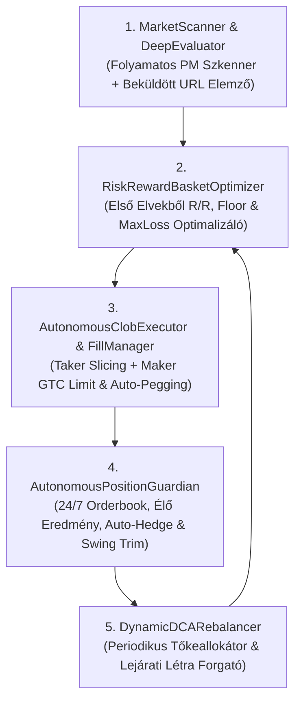

# Autonóm Polymarket Multi-Option & Futures Quant Engine — Mesterterv (Master Blueprint)

**Frissítve:** 2026-11-09  
**Státusz:** Általánosított, Anchoring-Mentes Matematikai és Architektúrális Specifikáció (a meglévő napi sportfogadási motor érintetlenül fut tovább)

---

## 1. Alapkoncepció és Első Elvekből Levezetett Optimalizációs Cél (`Zero-Anchoring & Zero-Memory`)

A rendszer alapvető matematikai és stratégiai küldetése: **olyan többopciós pozíció- és portfólió-struktúrák autonóm felépítése és aktív életciklus-menedzselése a Polymarket CLOB-on, amelyek a lehető legnagyobb bizonyossággal kizárják a befektetett tőke elvesztését, miközben a hozam/kockázat (`Risk/Reward`) arányt a lehető legmagasabb szinten maximalizálják.**

### 1.1. A Három Kötöttség- és Anchoring-Mentes Alaptörvény

1. **Tőkemegőrzés + Maximális Risk/Reward Együttes Optimalizálása (`Anti-Overinsurance & Anti-Ruin`):**
   - A rendszernek két szélsőséges hibát kell egyszerre elkerülnie:
     - **A vak spekulációt** (amikor a túl szűk lefedettség miatt magas a tőkevesztés kockázata), és
     - **A hozamgyilkos túlbiztosítást** (amikor a kosár olyan kimeneteleket is drágán megvesz, amelyek piaci ára meghaladja a valós fundamentális esélyüket, ezzel a nettó kifizetési plafont a lekötött tőkéhez képest elfogadhatatlanul alacsonyra szorítva).
   - A matematikai célfüggvény minden $B_t$ kumulált tőkeallokációra:
     $$\max_{\mathbf{q}} \quad \text{Risk/Reward}(\mathbf{q}) = \frac{\mathbb{E}[\text{Nettó Profit}(\mathbf{q})]}{\text{Védett Maximális Tőkevisszaesés}(\mathbf{q})}$$
     azon peremfeltétel mellett, hogy a valós, fundamentálisan életképes kimenetelek halmazán a tőkevesztés valószínűsége ($P(\text{PnL} < 0)$) a lehető legközelebb szoruljon a nullához, miközben a fő profittermelő ágakon a nettó hozam ($\frac{\text{Payout} - B_t}{B_t}$) maximális marad.

2. **Teljes Módszertani Szabadság (`Zero Anchoring Invariant`):**
   - Tilos a rendszert előre rögzített darabszámú kosarakhoz, fix százalékos sémákhoz, előre kiválasztott témákhoz vagy statikus receptekhez kötni.
   - A rendszer minden egyes vizsgált piacon **első elvekből (`first-principles`)**, kizárólag a kifizetési mátrixból, a CLOB könyvmélységből, a lejárati időből és a valós idejű fundamentális eloszlásból vezeti le, hogy az adott helyzetben melyik struktúra (vagy azok milyen dinamikus kombinációja) adja a legmagasabb `Risk/Reward` arányt a legkisebb tőkekockázat mellett.

3. **Szigorú Élő-Adat Invariáns (`Zero Memory Rule`):**
   - Soha, semmilyen döntéshez nem használható a nyelvi modell belső emlékezete vagy korábbi feltételezése. Minden egyes tényállítást és valószínűségi súlyt kizárólag az adott pillanatban lekérdezett, levágás (`truncation`) nélkül ellenőrzött élő API- és könyvadatokból kell származtatni.

---

## 2. Technikai és Szabályrendszeri Szétválasztás

| Dimenzió | Meglévő Napi Sportfogadási Engine (`betting_engine`) | Új Autonóm Polymarket Futures Engine (`pm_futures_engine`) |
| :--- | :--- | :--- |
| **Fő feladat** | Napi 100+ rövid lejáratú sporttipp (Stake manuális + Tier 4 PM) | Többopciós (`NegRisk` / Futures / Sávos) portfóliók autonóm építése és végigkereskedése |
| **Időhorizont** | 0 – 72 óra | Tetszőleges (napoktól több hónapig tartó lejárati létra) |
| **Tétkorlátok** | Szigorú `$0.50 – $8.00` Frakcionális Kelly | **Nincs `$8` plafon**; portfóliószintű tőkeallokáció (kezdőtőke + periodikus DCA rátöltések) |
| **Végrehajtási mód** | Stake-en manuális (`assumed manual`), szigorú Tier 1–4 kapukkal | **100% Autonóm CLOB végrehajtás** (`Maker` limit + `Taker` azonnali + automata `Order Slicer` + `Rebalancer`) |
| **Adatbázis** | [`data/engine.sqlite3`](file:///Users/belavarga/Betting_tips_engine/data/engine.sqlite3) (100% érintetlen) | Saját, különálló SQLite adatbázis: `data/pm_futures_ledger.sqlite3` |
| **Szabályzat (`Governance`)** | `AGENTS.md` 1–10. Parancsolat | Külön projektmappa **VAGY** külön `11. Charter` az `AGENTS.md`-ben és `GEMINI.md`-ben |

---

## 3. Általánosított Matematikai Logika és Risk/Reward ($R/R$) Keretrendszer

A rendszer bármely többopciós piacra ugyanazt a **négyfokozatú, első elvekből levezetett algoritmikus logikát** alkalmazza, mindenféle előre beégetett sablon nélkül:

### 3.1. A Kimenetelek Négy Funkcionális Halmazra Bontása (Élő Tényadatok vs. Orderbook Ár alapján)
A pillanatnyi, levágásmentes külső tényadatokból számított valós esély ($P_{\text{true}, i}$) és az élő piaci végrehajtási ár ($p_{\text{mkt}, i}$) összevetésével a rendszer az összes $N$ opciót 4 diszjunkt halmazba sorolja:

1. **Alulárazott Magas-Értékű Halmaz ($S_{\text{alpha}}$ — Fő Profittermelő Mag):**
   - Fundamentálisan ép, erős kimenetelek, amelyeket a piac a valós esélyük alatt áraz ($p_{\text{mkt}, i} < P_{\text{true}, i}$). Itt a legmagasabb az egységnyi tőkére jutó kifizetési szorzó és az árfolyam-felértékelődési potenciál.
2. **Teljes Áron Forgó Ép Favorit Halmaz ($S_{\text{base}}$ — Pozitív Bázis-Hozamú Pajzs):**
   - Magas valós esélyű, de a piac által már drágán árazott kimenetelek ($p_{\text{mkt}, i} \approx P_{\text{true}, i}$). Kihagyásuk túl nagy tőkevesztési kockázatot jelentene, túlsúlyozásuk viszont elszívná a tőkét az $S_{\text{alpha}}$ halmaztól.
3. **Időben Eltolandó / Fundamentálisan Romló Halmaz ($S_{\text{defer}}$ — Késleltetett Védelem):**
   - Olyan kimenetelek, amelyeket a piac múltbeli hírnév vagy tehetetlenség miatt még magas áron tart ($p_{\text{mkt}, i} > P_{\text{true}, i}$), miközben az aktuális tényadatok (sérülések, negatív sokkok, nehéz ütemezés) alapján az áruk várhatóan esni fog. Ezekre a 0. napon tilos drágán tőkét égetni; védelmüket időben eltolva (mély csapda-limittel vagy későbbi tőkebevonási lépcsőből, alacsonyabb áron) építjük ki.
4. **Kizárt / Zaj Halmaz ($S_{\text{noise}}$):**
   - Olyan kimenetelek, amelyek valós végső győzelmi esélye elhanyagolható ($P_{\text{true}, i} \approx 0$).

### 3.2. Kétszintű Aszimmetrikus Tőkeallokáció (`Graded Asymmetric Payout Optimization`)
Ahelyett, hogy minden kiválasztott kimenetelre mereven azonos darabszámot vennénk (ami a drága $S_{\text{base}}$ favoritok miatt lenyomná az össz-hozamot), vagy a favoritokon `$0` profittal érnénk be, a $B$ tőkét két kifizetési lépcsőre osztjuk:

1. **Pozitív Bázis-Hozam az Ép Favoritokon ($j \in S_{\text{base}}$):**
   - Minden $j \in S_{\text{base}}$ opcióból olyan $q_{\text{base}} = B \cdot (1 + R_{\text{base}})$ darabszámot veszünk ($R_{\text{base}} > 0$), amely még a legdrágább papírforma győzelme esetén is érdemi, garantált pozitív nettó profitot fizet:
     $$\text{Költség}_{\text{base}} = B \cdot (1 + R_{\text{base}}) \sum_{j \in S_{\text{base}}} p_j$$
2. **Maximális Kifizetési Koncentráció az Alulárazott Magon ($i \in S_{\text{alpha}}$):**
   - A fennmaradó tőkét ($B - \text{Költség}_{\text{base}}$) teljes egészében az alacsony összárú ($\sum_{i \in S_{\text{alpha}}} p_i \ll 1$) alulárazott halmazra koncentráljuk:
     $$q_{\text{alpha}} = \frac{B - \text{Költség}_{\text{base}}}{\sum_{i \in S_{\text{alpha}}} p_i} \gg q_{\text{base}} > B$$
   - Így az $S_{\text{alpha}}$ halmaz bármely elemének győzelme esetén kiemelkedő nettó profit ($\text{PnL}_{\text{alpha}} = q_{\text{alpha}} - B$) keletkezik, miközben az $S_{\text{base}}$ halmazon is biztosított a pozitív hozam ($\text{PnL}_{\text{base}} = q_{\text{base}} - B > 0$).

### 3.3. A Négy Kötelező Risk/Reward ($R/R$) Kiértékelési Metrika

1. **Passzív Alap-Hozam (`Baseline Hold-to-Maturity Return`):**
   - Garantált nettó dollárprofit és százalékos hozam mind az $S_{\text{alpha}}$, mind az $S_{\text{base}}$ kimeneteleken további kötések nélkül.
2. **Aktívan Tradelt Életciklus-Hozam (`Active Lifecycle Return`):**
   - Várható nettó profit a `Maker` limit árazás, a `clobRewards` jutalékok, az árfolyam-kiugrások részleges lefölözése (`Swing Trim`) és a periodikus ($\Delta B_k$) tőkeinjekciók diszkont-alapú (`Dip Accumulation`) elosztása mellett.
3. **Korlátozott Maximális Tőkevisszaesés (`Bounded Max Drawdown / Downside Risk`):**
   - Külön kimutatva a naiv lejáratkori kockázatot (`-100%`) és a **valós, autonóm módon védett kockázatot ($\text{MaxLoss}_{\text{guarded}} = \alpha_{\text{max}} \cdot B_t$)**. Mivel a kosárban lévő erős kimenetelek piaci eladási értéke (`Mark-to-Market Bid Value` = $\sum q_i \cdot \text{Bid}_i(t)$) végig likvid marad, egy kívülről érkező ($S_{\text{defer}}$ vagy új) kimenetel megerősödésekor az autonóm őrszem (`PositionGuardian`) időben végrehajtja a fedezést (`Auto-Hedge`) vagy a portfólió-lezárást (`Stop-Loss`).
4. **Valós Risk/Reward Arány (`Effective R/R Ratio`):**
   - $$\text{R/R}_{\text{effective}} = \frac{\text{PnL}_{\text{net}}}{\text{MaxLoss}_{\text{guarded}}}$$

### 3.4. Többpiacos Tőkeforgási Sebesség (`Capital Velocity`), Szekvenciális Tőkegörgetés és Topológia-Adaptáció
Amikor a rendszer párhuzamosan több különböző többopciós piacot ($\mathcal{E} = \{E_1, E_2, \dots, E_M\}$) értékel eltérő lejárati horizontokkal ($T_1 < T_2 < \dots < T_M$) és eltérő kiesési struktúrákkal, a tőkeallokációt három további első-elvű törvény vezérli:

1. **Időarányos Tőkeforgási Sebesség (`Time-Normalized Capital Velocity`):**
   - Két pozitív várható értékű és magas `Risk/Reward` arányú piac közül a rendszer nem csupán a statikus hozamot ($\text{ROI}_m$), hanem az **egységnyi lekötési időre jutó, kockázattal korrigált tőkeforgási sebességet** rangsorolja:
     $$\mathcal{V}(E_m) = \frac{\mathbb{E}[\text{PnL}_{\text{active}}(E_m)]}{B_m \cdot (T_m - t_0)}$$
   - A rövidebb lejáratú ($T_1 - t_0 \ll T_2 - t_0$), mélyebb kosár-diszkonttal ($\sum_{i \in S_{\text{alpha}} \cup S_{\text{base}}} p_i \ll \sum P_{\text{true}, i}$) és finomabb CLOB tick-lépésközzel rendelkező piacok magasabb prioritást kapnak az aktív tőkeallokációban.
2. **Szekvenciális Tőkegörgetés (`Sequential Capital Rollover & Compounding`):**
   - Eltérő lejárati idejű piacok ($T_1 < T_2$) esetén a rendszer nem kényszerül statikus „vagy–vagy” választásra:
     - **1. Fázis ($t_0 \to T_1$):** Az aktív tőkét és a periodikus DCA-rátöltések fő tömegét a közelebbi lejáratú, gyorsabb tőkeforgású $E_1$ piacra koncentrálja (miközben a távolabbi $E_2$ piacon kizárólag mély diszkontú, passzív `Maker` csapda-limiteket tart fenn).
     - **2. Fázis ($T_1 \to T_2$):** Amikor a korábbi $E_1$ piac a végjátékban profit-lockkal vagy elszámolással lezárul, a felszabaduló alaptőkét és a realizált profitot ($B_1 + \text{PnL}_1$) a rendszer **szekvenciálisan átforgatja (`Rollover`)** a későbbi lejáratú $E_2$ piacba közvetlenül annak magas információtartalmú, döntő szakasza előtt — így ugyanaz a tőke egyetlen éves cikluson belül többszörösen kamatozik.
3. **Kieséses Topológia és Strukturális Variancia-Adaptáció (`Elimination Topology Adaptation`):**
   - A valós győzelmi valószínűséget ($P_{\text{true}, i}$) és a kosárszélességet a rendszer mindig az adott piac **matematikai kiesési gráftopológiájából** vezeti le:
     - **Útfüggő kiemelési és erőnyerési aszimmetria (`Path & Bye Asymmetry`):** Ha a verseny- vagy elszámolási struktúrában bizonyos pozíciók kevesebb túlélési fordulót ($k_i < k_{\text{max}}$), gyengébb ágrajzi szomszédságot vagy strukturális helyzeti előnyt biztosítanak, a modell a túlélési láncszorzatot ($\prod_{r=1}^{k_i} p_{i,r}$) árazza a nyers múltbeli győzelmi arány helyett.
     - **Fordulónkénti mintaszám és kimeneteli variancia (`Single-Trial vs. Multi-Trial Variance`):** Ahol a kiesési fordulók egyetlen kísérletből ($n=1$, magas fordulónkénti variancia) állnak, ott a rendszer szélesebb valószínűségi lefedettséget ($\sum P_{\text{true}, i}$) és a végső fordulók előtti korai, kötelező részleges profit-rögzítést (`Pre-Final Profit-Lock`) alkalmaz; ahol viszont a továbbjutás többszörös mintavételű szérián ($n > 1$, alacsonyabb véletlen kiesési variancia) dől el, ott a szérián belüli állapotváltozásokra (`Intra-Series Swing Trim`) épít.

---

## 4. Dinamikus Életciklus-Kereskedés a Nyitástól a Lejáratig ($t_0 \to T$)

A rendszer a megnyitott pozíciókat **5 összekapcsolt mechanizmussal** menedzseli végig a lejáratig:

1. **Folyamatos Fundamentális vs. Piaci Divergencia-Mérés:**
   - Minden új eredmény, részadat vagy strukturális változás után minden $i$ opcióra frissíti a valós esély ($P_{\text{true}, i}(t)$) és a piaci ár ($p_{\text{mkt}, i}(t)$) hányadosát ($\text{Edge}_i(t) = P_{\text{true}, i}(t) / p_{\text{mkt}, i}(t)$).
2. **Aktív „Swing-Lefölözés” (`Free-Roll` tőketermelés):**
   - Ha egy olcsón felhalmozott opció ára rövid távú túlreagálás miatt jelentősen kiugrik, a rendszer a többlet share-ek optimális hányadát eladja a magas `Bid` árba, és a felszabaduló készpénzből azonnal az éppen alulárazott kosárbeli lábakat tölti fel.
   - Ha egy tartott opció fundamentuma tartósan összeomlik ($P_{\text{true}, i}(t) \to 0$), a rendszer nem várja meg a lejáratkori értéktelenedést, hanem még likvid `Bid` áron leépíti, és átmenti a tőkét az élő lábakba.
3. **A Periodikus Tőkeinjekciók ($\Delta B_t$) Határhaszon-Alapú Elosztása:**
   - Az új tőkét soha nem mechanikusan osztja szét, hanem mindig oda irányítja, ahol az egységnyi dollárra jutó kifizetési küszöb (`Payout Floor`) és a `Risk/Reward` a legnagyobbat nő:
     - **Diszkont-akkumuláció (`Buy the Dip`):** A legerősebb fundamentumú, de átmenetileg leütött árú lábak olcsó felhalmozása.
     - **A Tőkevédelmi Pajzs (`Floor`) utánhúzása** a megnövekedett $B_t$ össztőkéhez.
     - **Új felemelkedő esélyes (`Emerging Contender`) korai, olcsó beemelése** a kosárba.
4. **Időbeli Konvergencia-Aratás (`Elimination Harvesting`):**
   - Ahogy közeledik a lejárat, a mezőny esélytelen kimenetelei kiesnek, és a róluk felszabaduló valószínűségi tömeg törvényszerűen beáramlik a kosarunkban lévő élmezőnybe, folyamatosan növelve a portfólió `Mark-to-Market` eladási értékét.
5. **Önfinanszírozó Végjáték (`Endgame Lock-In & Early Exit`):**
   - Amikor már csak a végső esélyesek maradtak versenyben, a rendszer vagy bezárja a garantált profitot a könyvben, vagy megvárja a végső elszámolási kifizetést, illetve szükség esetén a feldrágult lábak töredékéből önfinanszírozó módon fedezi az esetleges külső kihívót.

---

## 5. A Három Matematikai Védőfék a Kódban (`Profitability & Safety Guards`)

1. **`Monotonic Payout Guard` (Túlkereskedés és Spread-Elvérzés Tilalma):**
   - A rendszer **kizárólag akkor** hajthat végre átcsoportosítást (`Rebalance / Swing`), ha a tranzakciós `Bid/Ask` spread levonása után a portfólió garantált kifizetési szintje vagy kockázattal korrigált értéke **szigorúan magasabb lesz, mint a kötés előtt volt**.
2. **`Dynamic Tail-Risk Shield` (Kívülről Érkező Esélyes Korai Levédése):**
   - Amint egy kezdetben kívül hagyott opció valós teljesítmény-mutatója átlép egy objektív statisztikai küszöböt, a rendszer még korai, diszkont árszinten kötelezően beemeli a védelembe, vagy érvényesíti a korlátozott `MaxLoss` védelmet.
3. **`Hard Budget & No-Naked-Leg Invariant`:**
   - A rendszer soha nem lépheti túl a jóváhagyott tőkekeretet, soha nem hagyhat félbe csonka kosarat fedezetlenül, és egyetlen kapcsolóval (`Kill-Switch`) bármikor megállítható.

---

## 6. Az Autonóm Szoftverrendszer 5 Moduljának Felépítése

1. **`MarketScanner & DeepEvaluator`:** Folyamatos Polymarket szkenner és beküldött URL-re azonnali, levágásmentes CLOB könyvmélység + külső tényadat-elemző.
2. **`RiskRewardBasketOptimizer`:** Első elvekből kiszámítja az alternatív pozíció-struktúrák passzív és aktív profitját, a védett maximális tőkevisszaesést ($\text{MaxLoss}_{\text{guarded}}$) és az effektív `Risk/Reward` arányt.
3. **`AutonomousClobExecutor & FillManager`:** A szűk spreadű lábakon azonnali szeletelt végrehajtást (`Order Slicing`), a szélesebb spreadű lábakon `Maker` (`GTC`) limit-kezelést végez automatikus utánállítással (`Cancel & Replace`).
4. **`AutonomousPositionGuardian`:** 24/7 pozíció-, orderbook- és élő tényadat-figyelő démon, amely végrehajtja a `Swing Trim` lefölözéseket és az `Auto-Hedge / Stop-Loss` védelmet.
5. **`DynamicDCARebalancer`:** A periodikus tőkeinjekciókat (pl. heti DCA) és a lejáró piacokról felszabaduló tőkét határhaszon-alapon osztja el.
