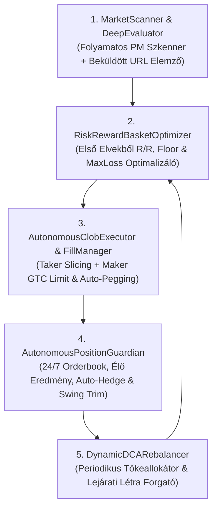

# Autonóm Polymarket Multi-Option & Futures Quant Engine — Mesterterv (Master Blueprint)

**Frissítve:** 2026-11-09  
**Státusz:** Általánosított, Anchoring-Mentes Matematikai és Architektúrális Specifikáció (a meglévő napi sportfogadási motor érintetlenül fut tovább)

---

## 1. Alapkoncepció és Első Elvekből Levezetett Optimalizációs Cél (`Zero-Anchoring & Zero-Memory`)

A rendszer alapvető matematikai és stratégiai küldetése: **olyan többopciós pozíció- és portfólió-struktúrák autonóm felépítése és aktív életciklus-menedzselése a Polymarket CLOB-on, amelyek a lehető legnagyobb bizonyossággal kizárják a befektetett tőke elvesztését, miközben a hozam/kockázat (`Risk/Reward`) arányt a lehető legmagasabb szinten maximalizálják.**

### 1.1. A Három Kötöttség- és Anchoring-Mentes Alaptörvény

1. **Tőkemegőrzés + Maximális Risk/Reward Együttes Optimalizálása (`Anti-Overinsurance & Anti-Ruin`):**
   - A rendszernek két szélsőséges hibát kell egyszerre elkerülnie:
     - **A vak spekulációt** (amikor a túl szűk lefedettség miatt magas a tőkevesztés kockázata), és
     - **A hozamgyilkos túlbiztosítást** (amikor a kosár olyan kimeneteleket is drágán megvesz, amelyek piaci ára meghaladja a valós fundamentális esélyüket, ezzel a nettó kifizetési plafont a lekötött tőkéhez képest elfogadhatatlanul alacsonyra szorítva).
   - A matematikai célfüggvény minden $B_t$ kumulált tőkeallokációra:
     $$\max_{\mathbf{q}} \quad \text{Risk/Reward}(\mathbf{q}) = \frac{\mathbb{E}[\text{Nettó Profit}(\mathbf{q})]}{\text{Védett Maximális Tőkevisszaesés}(\mathbf{q})}$$
     azon peremfeltétel mellett, hogy a valós, fundamentálisan életképes kimenetelek halmazán a tőkevesztés valószínűsége ($P(\text{PnL} < 0)$) a lehető legközelebb szoruljon a nullához, miközben a fő profittermelő ágakon a nettó hozam ($\frac{\text{Payout} - B_t}{B_t}$) maximális marad.

2. **Teljes Módszertani Szabadság (`Zero Anchoring Invariant`):**
   - Tilos a rendszert előre rögzített darabszámú kosarakhoz, fix százalékos sémákhoz, előre kiválasztott témákhoz vagy statikus receptekhez kötni.
   - A rendszer minden egyes vizsgált piacon **első elvekből (`first-principles`)**, kizárólag a kifizetési mátrixból, a CLOB könyvmélységből, a lejárati időből és a valós idejű fundamentális eloszlásból vezeti le, hogy az adott helyzetben melyik struktúra (vagy azok milyen dinamikus kombinációja) adja a legmagasabb `Risk/Reward` arányt a legkisebb tőkekockázat mellett.

3. **Szigorú Élő-Adat Invariáns (`Zero Memory Rule`):**
   - Soha, semmilyen döntéshez nem használható a nyelvi modell belső emlékezete vagy korábbi feltételezése. Minden egyes tényállítást és valószínűségi súlyt kizárólag az adott pillanatban lekérdezett, levágás (`truncation`) nélkül ellenőrzött élő API- és könyvadatokból kell származtatni.

---

## 2. Technikai és Szabályrendszeri Szétválasztás

| Dimenzió | Meglévő Napi Sportfogadási Engine (`betting_engine`) | Új Autonóm Polymarket Futures Engine (`pm_futures_engine`) |
| :--- | :--- | :--- |
| **Fő feladat** | Napi 100+ rövid lejáratú sporttipp (Stake manuális + Tier 4 PM) | Többopciós (`NegRisk` / Futures / Sávos) portfóliók autonóm építése és végigkereskedése |
| **Időhorizont** | 0 – 72 óra | Tetszőleges (napoktól több hónapig tartó lejárati létra) |
| **Tétkorlátok** | Szigorú `$0.50 – $8.00` Frakcionális Kelly | **Nincs `$8` plafon**; portfóliószintű tőkeallokáció (kezdőtőke + periodikus DCA rátöltések) |
| **Végrehajtási mód** | Stake-en manuális (`assumed manual`), szigorú Tier 1–4 kapukkal | **100% Autonóm CLOB végrehajtás** (`Maker` limit + `Taker` azonnali + automata `Order Slicer` + `Rebalancer`) |
| **Adatbázis** | [`data/engine.sqlite3`](file:///Users/belavarga/Betting_tips_engine/data/engine.sqlite3) (100% érintetlen) | Saját, különálló SQLite adatbázis: `data/pm_futures_ledger.sqlite3` |
| **Szabályzat (`Governance`)** | `AGENTS.md` 1–10. Parancsolat | Külön projektmappa **VAGY** külön `11. Charter` az `AGENTS.md`-ben és `GEMINI.md`-ben |

---

## 3. Általánosított Matematikai Logika és Risk/Reward ($R/R$) Keretrendszer

A rendszer bármely többopciós piacra ugyanazt a **négyfokozatú, első elvekből levezetett algoritmikus logikát** alkalmazza, mindenféle előre beégetett sablon nélkül:

### 3.1. A Kimenetelek Négy Funkcionális Halmazra Bontása (Élő Tényadatok vs. Orderbook Ár alapján)
A pillanatnyi, levágásmentes külső tényadatokból számított valós esély ($P_{\text{true}, i}$) és az élő piaci végrehajtási ár ($p_{\text{mkt}, i}$) összevetésével a rendszer az összes $N$ opciót 4 diszjunkt halmazba sorolja:

1. **Alulárazott Magas-Értékű Halmaz ($S_{\text{alpha}}$ — Fő Profittermelő Mag):**
   - Fundamentálisan ép, erős kimenetelek, amelyeket a piac a valós esélyük alatt áraz ($p_{\text{mkt}, i} < P_{\text{true}, i}$). Itt a legmagasabb az egységnyi tőkére jutó kifizetési szorzó és az árfolyam-felértékelődési potenciál.
2. **Teljes Áron Forgó Ép Favorit Halmaz ($S_{\text{base}}$ — Pozitív Bázis-Hozamú Pajzs):**
   - Magas valós esélyű, de a piac által már drágán árazott kimenetelek ($p_{\text{mkt}, i} \approx P_{\text{true}, i}$). Kihagyásuk túl nagy tőkevesztési kockázatot jelentene, túlsúlyozásuk viszont elszívná a tőkét az $S_{\text{alpha}}$ halmaztól.
3. **Időben Eltolandó / Fundamentálisan Romló Halmaz ($S_{\text{defer}}$ — Késleltetett Védelem):**
   - Olyan kimenetelek, amelyeket a piac múltbeli tehetetlenség miatt még magas áron tart ($p_{\text{mkt}, i} > P_{\text{true}, i}$), miközben az aktuális empirikus tényadatok és a hátralévő folyamat-struktúra alapján az áruk várhatóan korrigálni fog. Ezekre a 0. napon tilos drágán tőkét égetni; védelmüket időben eltolva, alacsonyabb árszinten építjük ki.
4. **Kizárt / Zaj Halmaz ($S_{\text{noise}}$):**
   - Olyan kimenetelek, amelyek valós végső győzelmi esélye elhanyagolható ($P_{\text{true}, i} \approx 0$).

### 3.2. Kétszintű Aszimmetrikus Tőkeallokáció (`Graded Asymmetric Payout Optimization`)
Ahelyett, hogy minden kiválasztott kimenetelre mereven azonos darabszámot vennénk (ami a drága $S_{\text{base}}$ favoritok miatt lenyomná az össz-hozamot), vagy a favoritokon `$0` profittal érnénk be, a $B$ tőkét két kifizetési lépcsőre osztjuk:

1. **Pozitív Bázis-Hozam az Ép Favoritokon ($j \in S_{\text{base}}$):**
   - Minden $j \in S_{\text{base}}$ opcióból olyan $q_{\text{base}} = B \cdot (1 + R_{\text{base}})$ darabszámot veszünk ($R_{\text{base}} > 0$), amely még a legdrágább papírforma győzelme esetén is érdemi, garantált pozitív nettó profitot fizet:
     $$\text{Költség}_{\text{base}} = B \cdot (1 + R_{\text{base}}) \sum_{j \in S_{\text{base}}} p_j$$
2. **Maximális Kifizetési Koncentráció az Alulárazott Magon ($i \in S_{\text{alpha}}$):**
   - A fennmaradó tőkét ($B - \text{Költség}_{\text{base}}$) teljes egészében az alacsony összárú ($\sum_{i \in S_{\text{alpha}}} p_i \ll 1$) alulárazott halmazra koncentráljuk:
     $$q_{\text{alpha}} = \frac{B - \text{Költség}_{\text{base}}}{\sum_{i \in S_{\text{alpha}}} p_i} \gg q_{\text{base}} > B$$
   - Így az $S_{\text{alpha}}$ halmaz bármely elemének győzelme esetén kiemelkedő nettó profit ($\text{PnL}_{\text{alpha}} = q_{\text{alpha}} - B$) keletkezik, miközben az $S_{\text{base}}$ halmazon is biztosított a pozitív hozam ($\text{PnL}_{\text{base}} = q_{\text{base}} - B > 0$).

### 3.3. A Négy Kötelező Risk/Reward ($R/R$) Kiértékelési Metrika

1. **Passzív Alap-Hozam (`Baseline Hold-to-Maturity Return`):**
   - Garantált nettó dollárprofit és százalékos hozam mind az $S_{\text{alpha}}$, mind az $S_{\text{base}}$ kimeneteleken további kötések nélkül.
2. **Aktívan Tradelt Életciklus-Hozam (`Active Lifecycle Return`):**
   - Várható nettó profit a `Maker` limit árazás, a `clobRewards` jutalékok, az árfolyam-kiugrások részleges lefölözése (`Swing Trim`) és a periodikus ($\Delta B_k$) tőkeinjekciók diszkont-alapú (`Dip Accumulation`) elosztása mellett.
3. **Korlátozott Maximális Tőkevisszaesés (`Bounded Max Drawdown / Downside Risk`):**
   - Külön kimutatva a naiv lejáratkori kockázatot (`-100%`) és a **valós, autonóm módon védett kockázatot ($\text{MaxLoss}_{\text{guarded}} = \alpha_{\text{max}} \cdot B_t$)**. Mivel a kosárban lévő erős kimenetelek piaci eladási értéke (`Mark-to-Market Bid Value` = $\sum q_i \cdot \text{Bid}_i(t)$) végig likvid marad, egy kívülről érkező ($S_{\text{defer}}$ vagy új) kimenetel megerősödésekor az autonóm őrszem (`PositionGuardian`) időben végrehajtja a fedezést (`Auto-Hedge`) vagy a portfólió-lezárást (`Stop-Loss`).
4. **Valós Risk/Reward Arány (`Effective R/R Ratio`):**
   - $$\text{R/R}_{\text{effective}} = \frac{\text{PnL}_{\text{net}}}{\text{MaxLoss}_{\text{guarded}}}$$

### 3.4. Többpiacos Tőkeforgási Sebesség (`Capital Velocity`), Szekvenciális Tőkegörgetés és Topológia-Adaptáció
Amikor a rendszer párhuzamosan több különböző többopciós piacot ($\mathcal{E} = \{E_1, E_2, \dots, E_M\}$) értékel eltérő lejárati horizontokkal ($T_1 < T_2 < \dots < T_M$) és eltérő kiesési struktúrákkal, a tőkeallokációt három további első-elvű törvény vezérli:

1. **Időarányos Tőkeforgási Sebesség (`Time-Normalized Capital Velocity`):**
   - Két pozitív várható értékű és magas `Risk/Reward` arányú piac közül a rendszer nem csupán a statikus hozamot ($\text{ROI}_m$), hanem az **egységnyi lekötési időre jutó, kockázattal korrigált tőkeforgási sebességet** rangsorolja:
     $$\mathcal{V}(E_m) = \frac{\mathbb{E}[\text{PnL}_{\text{active}}(E_m)]}{B_m \cdot (T_m - t_0)}$$
   - A rövidebb lejáratú ($T_1 - t_0 \ll T_2 - t_0$), mélyebb kosár-diszkonttal ($\sum_{i \in S_{\text{alpha}} \cup S_{\text{base}}} p_i \ll \sum P_{\text{true}, i}$) és finomabb CLOB tick-lépésközzel rendelkező piacok magasabb prioritást kapnak az aktív tőkeallokációban.
2. **Szekvenciális Tőkegörgetés (`Sequential Capital Rollover & Compounding`):**
   - Eltérő lejárati idejű piacok ($T_1 < T_2$) esetén a rendszer nem kényszerül statikus „vagy–vagy” választásra:
     - **1. Fázis ($t_0 \to T_1$):** Az aktív tőkét és a periodikus DCA-rátöltések fő tömegét a közelebbi lejáratú, gyorsabb tőkeforgású $E_1$ piacra koncentrálja (miközben a távolabbi $E_2$ piacon kizárólag mély diszkontú, passzív `Maker` csapda-limiteket tart fenn).
     - **2. Fázis ($T_1 \to T_2$):** Amikor a korábbi $E_1$ piac a végjátékban profit-lockkal vagy elszámolással lezárul, a felszabaduló alaptőkét és a realizált profitot ($B_1 + \text{PnL}_1$) a rendszer **szekvenciálisan átforgatja (`Rollover`)** a későbbi lejáratú $E_2$ piacba közvetlenül annak magas információtartalmú, döntő szakasza előtt — így ugyanaz a tőke egyetlen éves cikluson belül többszörösen kamatozik.
3. **Kieséses Topológia és Strukturális Variancia-Adaptáció (`Elimination Topology Adaptation`):**
   - A valós győzelmi valószínűséget ($P_{\text{true}, i}$) és a kosárszélességet a rendszer mindig az adott piac **matematikai kiesési gráftopológiájából** vezeti le:
     - **Útfüggő kiemelési és erőnyerési aszimmetria (`Path & Bye Asymmetry`):** Ha a verseny- vagy elszámolási struktúrában bizonyos pozíciók kevesebb túlélési fordulót ($k_i < k_{\text{max}}$), gyengébb ágrajzi szomszédságot vagy strukturális helyzeti előnyt biztosítanak, a modell a túlélési láncszorzatot ($\prod_{r=1}^{k_i} p_{i,r}$) árazza a nyers múltbeli győzelmi arány helyett.
     - **Fordulónkénti mintaszám és kimeneteli variancia (`Single-Trial vs. Multi-Trial Variance`):** Ahol a kiesési fordulók egyetlen kísérletből ($n=1$, magas fordulónkénti variancia) állnak, ott a rendszer szélesebb valószínűségi lefedettséget ($\sum P_{\text{true}, i}$) és a végső fordulók előtti korai, kötelező részleges profit-rögzítést (`Pre-Final Profit-Lock`) alkalmaz; ahol viszont a továbbjutás többszörös mintavételű szérián ($n > 1$, alacsonyabb véletlen kiesési variancia) dől el, ott a szérián belüli állapotváltozásokra (`Intra-Series Swing Trim`) épít.

### 3.5. Nem-Kizárólagos Útfüggő Korlát-Piacok (`First-Passage Barrier Lattices`) és Likviditással Korrigált Piacszűrés
Amikor a vizsgált esemény nem egymást kizáró partíciókból ($\sum Y_i = 1$), hanem egy folytonos alapfolyamat $\{S_t\}_{t \in [t_0, T]}$ futó maximumára ($M_T = \sup_{t \in [t_0, T]} S_t \ge K_u$) és futó minimumára ($m_T = \inf_{t \in [t_0, T]} S_t \le K_d$) kiírt, nem-kizárólagos érintési korlátokból (`negRisk = False`, `One-Touch Barrier Lattice`) áll, a rendszer az alábbi első-elvű szabályokat érvényesíti:

1. **Belső Érintési Konvexitás ($S_{\text{alpha}}$) és Külső Folyosó-Pajzs ($S_{\text{base}}$) Szintézise:**
   - Mivel a felső és alsó érintési korlátok nem zárják ki egymást, egyetlen időszakon belül mindkét irányú korlát teljesülhet (`Double-Touch Convexity`: $M_T \ge K_{u,1}$ és $m_T \le K_{d,1}$ egyaránt fizet).
   - Ha azonban a rendszer kizárólag belső `YES` érintési opciókat tartana, az alapfolyamat szűk sávba ragadása (`Dead-Zone`: $K_{d,1} < m_T \le M_T < K_{u,1}$) időérték-vesztést (`Theta Decay`) okozna.
   - Ezt a rendszer úgy küszöböli ki, hogy a belső `YES` érintési párt ($S_{\text{alpha}}$: $M_T \ge K_{u,1}$ és $m_T \le K_{d,1}$) kombinálja a távolabbi, múltbeli ársokkok miatt túlárazott szélső korlátok `NO` oldalával ($S_{\text{base}}$: $M_T < K_{u,2}$ és $m_T > K_{d,2}$, ahol $K_{u,2} > K_{u,1}$ és $K_{d,2} < K_{d,1}$):
     - **Kettős kifizetés normál kitörésnél:** Amikor az alapfolyamat eléri a belső korlátot, de nem töri át a szélső sokk-korlátot ($K_{u,1} \le M_T < K_{u,2}$ vagy $K_{d,2} < m_T \le K_{d,1}$), a belső `YES` láb és az összes külső `NO` pajzs-láb **egyszerre fizet**.
     - **Időérték- és oldalazási védelem (`Theta Cushion`):** Ha az alapfolyamat végig a belső sávban oldalazik, az összes külső `NO` pajzs-láb garantáltan nyer, és az idő előrehaladtával felértékelődve kompenzálja a belső `YES` lábak időérték-vesztését.
2. **Szekvenciális Első-Érintési Lefölözés (`Sequential First-Passage Harvest`) és Félidei `Theta-Guard`:**
   - Mivel a felső és alsó korlátok érintési megállási ideje ($\tau_u \ne \tau_d$) időben elválik egymástól, a rendszer soha nem tartja passzívan mindkét belső lábat a lejáratig:
     - **Első érintés lefölözése (`Free-Roll Conversion`):** Amint az alapfolyamat megközelíti vagy eléri az első belső korlátot ($\tau_1 = \min(\tau_u, \tau_d)$), a rendszer realizálja a nyertes belső `YES` lábat és a vele azonos irányban felértékelődött külső `NO` pajzsokat, így készpénzben bebiztosítja a tőkét, miközben az ellenoldali belső `YES` lábat **kockázatmentes fordulós opcióként (`Free-Roll Reversal`)** hagyja futni a hátralévő $[\tau_1, T]$ időszakra.
     - **Optimális megállási időérték-stop (`Mid-Horizon Theta Stop-Loss`):** Ha a hátralévő futamidő matematikailag meghatározott kritikus hányadáig egyik belső korlát sem kerül érintésközelbe, az őrszem (`PositionGuardian`) a felértékelődött külső `NO` pajzsokkal együtt lezárja a pozíciót, szigorúan korlát alatt tartva a maximális tőkevisszaesést ($\text{MaxLoss}_{\text{guarded}}$).
3. **Árazási Hatékonyság és Könyvmélység-Szűrés (`Efficiency & Liquidity-Adjusted R/R Filter`):**
   - Azokon a piacokon, ahol az opciós árakat folyamatos algoritmikus volatilitás-modellek jegyzik (így az implikált érintési valószínűség szorosan követi a realizált ugrásos-diffúziós volatilitást, az aktív korlátok könyvmélysége pedig sekély a célzott $B$ allokációhoz képest), az elérhető matematikai él (`Edge`) és az effektív `Risk/Reward` törvényszerűen alacsonyabb, mint a lassan frissülő, emberi/fundamentális konszenzus által félreárazott piacokon.
   - A rendszer ezért minden piacot a **likviditással és csúszással (`Slippage`) korrigált effektív `Risk/Reward`** alapján rangsorol, és a tőkét automatikusan a mély könyvű, magas strukturális félreárazású piacok felé súlyozza.

### 3.6. Hierarchikus Részhalmaz-Monotonitás, Kétlépcsős Éllovas-Korrekció, Ugráskockázati Szűrés és Keresztpiaci Ortogonalizáció
A többpiacos univerzum pásztázása és a portfóliószintű tőkeallokáció során a rendszer öt további, első elvekből levezetett matematikai invariánst érvényesít:

1. **Hierarchikus Esemény-Monotonitás és Előfeltétel-Arbitrázs (`Sub-Event Probability Monotonicity & Prerequisite Arbitrage`):**
   - Ha egy végső kimenetel $A_i$ matematikailag csak akkor következhet be, ha előbb teljesül egy közbenső rész-esemény $B_i$ ($A_i \subset B_i$, tehát $A_i$ szigorú részhalmaza $B_i$-nek, és $T_B \le T_A$), akkor a valószínűségszámítás axiómája szerint minden $i$-re kötelezően fennáll:
     $$P_{\text{true}}(B_i) = \frac{P_{\text{true}}(A_i)}{P_{\text{true}}(A_i \mid B_i)} \ge P_{\text{true}}(A_i)$$
   - Amennyiben a rész-esemény piacán ($E_B$) egyetlen túlkergetett opció torzítása miatt a többi esélyes opció piaci ára $p_{\text{mkt}}(B_i) \le p_{\text{mkt}}(A_i)$ (vagy $p_{\text{mkt}}(B_i) / p_{\text{mkt}}(A_i) \ll P_{\text{true}}(B_i) / P_{\text{true}}(A_i)$), a rendszer a végső $E_A$ piac helyett **automatikusan a rész-esemény $E_B$ piacát részesíti előnyben**, mivel az alacsonyabb vagy azonos belépési áron nyújt magasabb valós bekövetkezési valószínűséget, kevesebb hátralévő kiesési fordulót és korábbi lejáratot ($T_B \le T_A$).
2. **Kétlépcsős Éllovas-Korrekciós Allokáció és Szintetikus Komplementer-Diszkont (`Two-Stage Dominant-Leader Mean-Reversion & Synthetic Complement Discount`):**
   - Ha egy hosszú, sokfordulós kumulatív folyamat korai szakaszában egyetlen éllovas opció piaci ára extrém módon elszakad a fundamentális valós valószínűségétől ($p_{\text{mkt}, 1} \gg P_{\text{true}, 1}$, miközben a hátralévő időszakban magas nehézségű katalizátor-ablak következik), az éllovas 0. napi megvétele ($t_0$-ban) lerontaná a portfólió kifizetési küszöbét (`Payout Floor`).
   - Ilyen topológia esetén a rendszer **Kétlépcsős Mean-Reversion Allokációt** hajt végre:
     - **1. Lépcső ($t_0$ — Szintetikus Üldöző Kosár):** Ha a matematikailag életképes üldöző opciók halmazának ($S_{\text{chasers}}$) együttes `YES` ára szigorúan olcsóbb, mint az éllovas közvetlen `NO` szerződése ($\sum_{j \in S_{\text{chasers}}} p_{\text{YES}, j} < p_{\text{NO}, 1}$), a rendszer a tőke első részéből ($\alpha B$) egyenlő darabszámú ($Q_{\text{chaser}}$) üldöző kosarat épít. Ez olcsóbb szintetikus belépést, többszörös `Maker` jutalmat és lábankénti egyedi `Swing Trim` lehetőséget biztosít.
     - **2. Lépcső ($\tau_{\text{dip}}$ — Likviditási Tartalék és Erőd-Bezárás):** A tőke fennmaradó részét ($(1-\alpha)B$) a rendszer készpénz-tartalékban / mély passzív `Maker` limitben (`Stink-Bid`) tartja az éllovas korrekciós árszintjén ($p_{\text{limit}, 1} \le P_{\text{true}, 1}$). Amikor az éllovas a nehéz katalizátor-ablakban korrigál, a rendszer vagy azonnal realizálja a felértékelődött üldöző kosár `Swing` profitját, vagy a tartalékból megvásárolja a leértékelt éllovast, bezárva a teljes élmezőnyre kiterjedő pozitív kifizetési erődöt (`Fortress Lock-In`).
3. **Diszkontinuus Ugráskockázat (`Poisson Jump / Gap-to-Zero`) vs. Folytonos Állapotfejlődés Szűrése:**
   - Az autonóm `PositionGuardian` által számított védett maximális veszteség ($\text{MaxLoss}_{\text{guarded}} \ll B$) matematikai előfeltétele, hogy a mögöttes valószínűségi folyamat lépésenként, köztes likvid kereskedési ablakokkal fejlődjön (ahol egy részleges kedvezőtlen esemény csak fokozatos, $\Delta p < 1$ árelmozdulást okoz).
   - Azokon az eseménypiacokon, ahol az elszámolást egyetlen külső, diszkontinuus bejelentés (`Poisson Jump Process`) dönti el — amely egyetlen pillanat alatt, köztes könyv-likviditás nélkül ugrasztja az árat $p_t \to 0$ vagy $p_t \to 1$ értékre (`Overnight Gap Risk`) —, az egyedi lábra épített `Stop-Loss` matematikailag végrehajthatatlan. Ilyen piacokon a kockázat kizárólag egyedi pozíció-sapkával (`Position-Cap Diversification`, $\max_i C_i \le \bar{c}$) korlátozható, és sekély könyvmélység esetén a rendszer ezeket automatikusan hátrasorolja a folytonos állapotfejlődésű, magas `Risk/Reward` kosár-piacok mögé.
4. **Rejtett „Egyéb / Nevesítetlen” Partíciós Kockázat Kizárása (`Unlisted / Placeholder Partition Exclusion Guard`):**
   - Egy `NegRisk` tábla csak akkor tekinthető matematikailag zárt partíciónak ($\sum_{i \in \mathcal{M}_{\text{named}}} P_{\text{true}, i} \approx 1$), ha a külső valós tényadatok szerinti összes érdemi esélyes szereplő **nevesített, önállóan kereskedhető szerződéssel** rendelkezik a táblán.
   - Ha az élő külső rangsorok vagy tényadatok alapján a valós élmezőny bármelyik érdemi szereplője hiányzik a nevesített szerződések közül (és így rejtett módon az `Other` vagy nem aktivált `Placeholder` szerződésbe esik), a rendszer a piacot **automatikusan kizárja** a fő tőkeallokációból, megelőzve a fedezetlen strukturális csonkolási kockázatot.
5. **Keresztpiaci Korrelációs Ortogonalizáció (`Cross-Market Covariance & Duplication Pruning`):**
   - Amikor a szkenner több olyan magas `Risk/Reward` piacot talál, amelyek ugyanarra az alapfolyamatra vagy részben átfedő kimenetel-halmazokra épülnek ($\text{Cov}(E_a, E_b) > 0$), a rendszer **soha nem allokál párhuzamos teljes tőkét mindkét átfedő piacra**, mert az megsokszorozná az azonos faktor-kockázatot (`Factor Concentration`).
   - Ehelyett az átfedő klaszterből kiválasztja a magasabb effektív `Risk/Reward` és gyorsabb tőkeforgási sebességű ($\mathcal{V}$) reprezentánst — vagy a főpiacot felbontja egymással páronként diszjunkt, függetlenül nyerő rész-piacokra ($E_{b,1} \cap E_{b,2} = \emptyset$, amelyek egyszerre is fizethetnek és korábban járnak le) —, így a teljes portfólió kizárólag **egymástól ortogonális (korrelálatlan) alfa-forrásokból** épül fel.

### 3.7. Bayes-féle Időstruktúra-Megmaradás, Valós Könyvmélység-Audit és Koncentrációs Entrópia Szűrők
Az önellenőrző matematikai és mikrostruktúra-auditok alapján a rendszer négy további szigorú szűrőt érvényesít minden vizsgált piacra:

1. **Bayes-féle Naptári Időérték-Megmaradási Törvény (`Bayesian Term-Structure Theta Conservation Law`):**
   - Ha ugyanarra a megállási időre ($\tau$) két egymásba ágyazott lejáratú bináris szerződés ($T_1 < T_2$, $\{\tau \le T_1\} \subset \{\tau \le T_2\}$) létezik, a teljes valószínűség törvénye miatt $p(\text{NO}_{T_1}) + p(\text{YES}_{T_2}) = (1 - P_1) + (P_1 + \Delta P_{1 \to 2}) = 1 + \Delta P_{1 \to 2}$.
   - Amennyiben a $T_1$ lejáratig az esemény nem következik be ($\tau > T_1$), a hosszabb lejáratú $\text{YES}_{T_2}$ opció árából a $P_1$ komponens **teljesen lenullázódik**, és $T_1$-kori kondicionális értéke a Bayes-tétel szerint $\frac{\Delta P_{1 \to 2}}{1 - P_1}$ szintre esik vissza — ami a tranzakciós spreadekkel együtt kioltja a $\text{NO}_{T_1}$ lábon realizált alap-nyereséget. Ezért egyedi bináris ugráskockázatú piacokon a naptári ellentétes láb **nem használható ingyenes tőkevédelmi pajzsként**.
2. **Aktív vs. Fantom Könyvmélység Szétválasztása (`Effective Contender Depth vs. Dead-Tail Liquidity Filter`):**
   - A rendszer soha nem az esemény összesített (főoldali) likviditását ($\sum_{i=1}^N L_i$) veszi alapul, mert annak meghatározó része esélytelen, szélső ($p_i \to 0$) opciók passzív eladási falaiban (`Dead-Tail Liquidity`) ülhet.
   - A végrehajthatósági szűrő kizárólag az érdemi esélyesek halmazának ($i \in S_{\text{alpha}} \cup S_{\text{base}}$) a célzott belépési ársávon belüli kumulatív könyvmélységét ($L_{\text{eff}}$), az azonnali `Taker` csúszást (`Slippage`) és a tényleges minimum árlépésközt (`orderPriceMinTickSize`) méri.
3. **Koncentrációs Entrópia, Duopólium-Kompresszió és Állapotváltozási Katalizátor (`Entropy & State-Transition Catalyst Requirement`):**
   - Egy `NegRisk` ($\sum Y_i = 1$) piac csak akkor alkalmas magas `Risk/Reward` kosár-allokációra, ha a valószínűségi tömeg kellő entrópiával oszlik meg több életképes opció között, így a kiválasztott kosár belépési összára a célzott `Risk/Reward` és a tranzakciós költségek függvényében elégséges diszkont-marzsot biztosít ($\sum_{i \in S_{\text{basket}}} p_i \le 1 - \delta(\text{Spread}, \sigma, \text{R/R})$).
   - Ha a piac két domináns opció szűk duopóliumává préselődött össze ($p_1 + p_2 \to 1$), a kosár-arbitrázs marzsa eltűnik. Kétlépcsős éllovas-korrekciós (`Mean-Reversion`) stratégiát pedig kizárólag akkor szabad indítani, ha a hátralévő időszakban előre ismert, kötelező állapotváltozási események kényszerítik az éllovast folyamatos kockázatvállalásra; stacionárius, kényszerítő esemény nélküli folyamatokban a középértékhez való visszatérés nem feltételezhető.
4. **Várakozó Limit vs. Teljesült Pozíció Jutalom-Elszámolás (`Resting-Order vs. Filled-Inventory Accounting`):**
   - A CLOB likviditási jutalmak (`clobRewards`) kizárólag a könyvben várakozó, még nem teljesült (`unfilled resting limit`) megbízások időarányos jelenlétéért járnak; a már teljesült és megtartott (`filled inventory`) pozíciók várható hozamába tilos napi jutalom-hozamot beszámítani.

### 3.8. Kilenc Általánosított, Anchoring-Mentes Logikai Invariáns (`First-Principles Structural & Microstructural Laws`)
A többpiacos könyv-, folyamat- és fundamentális auditokból a rendszer kilenc egyetemes, minden konkrét témától és rögzített számtól független logikai törvényt érvényesít:

1. **A Valós Kiszállási Kockázat Könyv-Integrál Törvénye (`Endogenous Orderbook Liquidation Risk vs. Assumed Stop-Loss`):**
   - A védett maximális tőkevisszaesés ($\text{MaxLoss}_{\text{guarded}}$) **soha nem lehet kívülről feltételezett konstans vagy statikus százalék**.
   - Minden $t$ időpontban a ténylegesen realizálható kiszállási értéket kizárólag az élő vételi könyv (`Bid Ladder`) kumulatív mélységi integrálja és a folyamat egy lépésben bekövetkező maximális ugrása ($\Delta p_i$) határozza meg:
     $$\text{Valós Likvidációs Érték}(\mathbf{q}, t) = \sum_{i \in S} \int_{0}^{q_i} \text{Bid}_i(u, t)\,du$$
   - Korlátozott tőkevisszaesés ($\text{MaxLoss}_{\text{guarded}} \ll B$) kizárólag ott létezik, ahol (a) a vételi könyv mélysége a tartott $q_i$ mennyiségen belül elnyeli a megbízást, és (b) az alapfolyamat két kereskedési ablak között nem tartalmaz elnyelő ($\Delta p_i = -p_i$) szakadékot. Ahol ez a két feltétel nem teljesül, ott a rendszer a teljes befektetett összeget ($B$) tekinti valós kockázatnak.
2. **A Kétirányú Könyv-Aszimmetria és Végrehajtási Szétválasztás Törvénye (`Bid-Depth vs. Ask-Depth Decoupling`):**
   - A legfelső `Best Bid / Best Ask` különbözet önmagában elégtelen mutató, mert a belépési súrlódást az **eladási könyv (`Ask Ladder`) integrálja**, míg a kiszállási biztonságot a **vételi könyv (`Bid Ladder`) integrálja** határozza meg. Az árlépésközt (`orderPriceMinTickSize`) a rendszer minden egyes opció saját könyv-konfigurációjából olvassa ki.
   - Ha egy opció vételi (`Bid`) fala mély (azonnali kiszállási védelem biztosított), de az eladási (`Ask`) oldala sekély, a rendszernek tilos `Taker` megbízással felvernie az árat vagy eldobnia az opciót: a belépést **automatikusan passzív `Maker` akkumulációra kell kapcsolnia**, kihasználva az alattunk álló vételi fal által nyújtott aszimmetrikus védelmet.
3. **Fázisváltó Stochasztikus Folyamatok Törvénye (`Non-Absorbing Diffusion Phase vs. Absorbing Elimination Phase`):**
   - Hosszú futamidejű többopciós folyamatokat tilos a nyitástól a lejáratig ($[t_0, T]$) homogén rezsimként kezelni. A rendszer matematikailag különválasztja a két fázist:
     - **Diffúziós / Akkumulációs Rezsim ($t \in [t_0, T_{\text{absorb}})$):** Nincs végleges kiesés ($P(\text{abszorpció}_i) = 0$), az elemi események csak kis ($\Delta p_i \ll p_i$) árelmozdulást okoznak, és a túlértékelt opciók lokális korrekciós ciklusokon mennek keresztül. Ebben a fázisban a rendszer a belső értékhez való konvergenciát (`Convergence Harvesting`) és a diszkont-akkumulációt maximalizálja.
     - **Elnyelő / Kieséses Rezsim ($t \in [T_{\text{absorb}}, T]$):** Aktiválódnak a $p_i \to 0$ elnyelő korlátok. A rezsimváltás határán ($T_{\text{absorb}}$) a rendszer kötelezően vagy **likvidálja a felértékelődött pozíciót a mély `Bid` könyvbe**, vagy **zárt partícióvá (`Closed Partition Lock-In`) egészíti ki az állva maradt halmazt**, nullára szorítva a fedezetlen kiesési kockázatot.
4. **Folytonos Belső Intenzitás-Jel vs. Zajos Bináris Felszíni Mutató (`Latent Continuous Signal vs. Noisy Binary Tally`):**
   - Kis és közepes mintaszámnál a durva bináris kimenetel-számlálók (pl. nyers győzelem/vereség arány vagy pillanatnyi helyezés) magas véletlen varianciát hordoznak, míg a folytonos kumulatív teljesítmény-intenzitási mutatók (pl. egységnyi kísérletre jutó nettó hatékonyság- vagy különbség-eloszlás) sokkal magasabb jel/zaj aránnyal jelzik előre a végső eloszlást.
   - A legmagasabb kockázat/hozam arányú (`$S_{\text{alpha}}$`) lehetőségek ott keletkeznek, ahol a piac a zajos bináris felszíni mutatót árazza, miközben a folytonos belső intenzitás-mutató alapján az opció valós ereje megegyezik a többszörös áron forgó éllovaséval.
5. **Atomi Állapot-Szinkronizáció és Elsődleges Likviditási Gravitáció (`Atomic State Synchronization & Primary-Pool Dominance`):**
   - Keresztpiaci vagy fundamentális összevetés kizárólag **ugyanazon $t$ időpillanatban, atomi módon lekérdezett teljes könyv- és állapotadatok** alapján végezhető; korábbi rész-állapotok összevetése szigorúan tilos.
   - Ha egy eseménycsaládon belül a főpiac effektív könyvmélysége ($L_{\text{eff}}$) nagyságrendekkel meghaladja a rész-piacokét és a `Bid-Ask` spreadje töredéke azokénak, a rendszer az elsődleges likviditási medencét részesíti előnyben, mert a garantált kiszállási mélység magasabb valós, csúszással korrigált `Risk/Reward` arányt biztosít.
6. **Önfinanszírozó Likviditási Tartalék és Dinamikus Partíció-Zárás (`Cash-Buffer Optionality & Self-Financing Partition Closure`):**
   - Amikor egy domináns opció a diffúziós fázisban túlhevült áron forog ($p_{\text{mkt}, 1} \gg P_{\text{true}, 1}$), a rendszer sem a hozamgyilkos azonnali túlfizetést, sem a fedezetlenül hagyott 100%-os tőkeelköltést nem választja.
   - Ehelyett vagy már $t_0$-ban beemeli az éllovast a pozitív bázis-hozamú pajzsba ($S_{\text{base}}$) amennyiben a teljes kosár összára jelentős diszkontot hagy ($\sum_{i \in S_{\text{basket}}} p_i \ll 1$), vagy a tőke meghatározott hányadát ($(1-\alpha)B$) dedikált likvid tartalékban / diszkont `Maker` limitben tartja, és az alulárazott $S_{\text{alpha}}$ mag konvergencia-nyereségének részleges lefölözésével (`Swing Trim`) kombinálva **önfinanszírozó módon zárja be a hiányzó éllovas lábat** még az elnyelő fázis kezdete előtt.
7. **Al-Partíciós Kizárólagossági és Határhaszon-Telítődési Törvény (`Sub-Partition Exclusivity & Marginal Coverage Saturation Law`):**
   - Ha egy többopciós partíció egymást kizáró, párhuzamos rész-ágakra ($\mathcal{M} = \bigsqcup_{g=1}^G \mathcal{M}_g$, ahol minden $g$ rész-ágból legfeljebb $m_g$ darab opció juthat tovább a végső döntő szakaszba) bomlik, akkor egyetlen $\mathcal{M}_g$ rész-ág túltöltése belső önkannibalizációt (`Intra-Branch Cannibalization`) okoz.
   - Egy újabb $k \in \mathcal{M}_g$ opció kosárba emelése kizárólag akkor növeli az effektív `Risk/Reward` arányt, ha a hozott pótlólagos túlélési valószínűségi tömeg ($\Delta P_{\text{true}, k \mid \mathcal{M}_g}$) meghaladja a meglévő $S_{\text{alpha}}$ lábakon okozott kifizetés-hígulást ($\Delta q_{\text{alpha}} = q_{\text{alpha}}(S) - q_{\text{alpha}}(S \cup \{k\})$), ÉS az új opció saját vételi könyvének integrálja ($\int_0^{q_k} \text{Bid}_k(u)\,du$) nem rontja le a kosár aggregált azonnali likvidációs hányadosát.
8. **Kontraciklikus Periodikus Tőkeallokáció és Kompressziós Megállási Szabály (`Counter-Cyclical DCA & Basket-Compression Stopping Rule`):**
   - Periodikus tőkeinjekciók ($\Delta B_t$) esetén az új tőkét **tilos mechanikusan, időpont-vezérelten arányosan szétosztani** az összes tartott opció között, mert az a pillanatnyilag lokális csúcson forgó opciók drága megvásárlását eredményezi.
   - Minden $t$ rátöltési ciklusban a rendszer:
     - **A) Utánhúzza a kifizetési küszöböt (`Payout Floor Ratcheting`):** A kumulált tőke ($B_t = B_{t-1} + \Delta B_t$) növekedésével arányosan emeli az alap-kifizetési küszöböt ($Q_{\text{floor}}(t) \ge (1 + R_{\text{base}}) B_t$).
     - **B) Kontraciklikusan irányítja a végrehajtást (`Mean-Reversion Dip Routing`):** Az azonnali végrehajtás kizárólag azokra az ép belső intenzitás-jelű ($Z_{\text{latent}, i}(t)$) opciókra irányul, amelyek piaci ára negatív rövid távú reziduális eltérést ($\Delta p_i(t) < 0$) mutat; a pozitív kilengésű ($\Delta p_i(t) > 0$) lábak kvótáját a meglévő többlet-készlet (`Surplus Inventory`) vagy passzív diszkont `Maker` limit fedezi.
     - **C) Érvényesíti az Ár-Kompressziós Megállási Határt (`Compression Cutoff`):** Ahogy az esélytelen kimenetelek ($\mathcal{M} \setminus S_{\text{basket}}$) valószínűségi tömege kiürül és beáramlik az élmezőnybe, a kosár összára ($\Sigma_{\text{basket}}(t) = \sum_{i \in S_{\text{basket}}} p_i(t)$) monoton közelít az $1.0$-hez. Amint a kosár diszkont-marzsa a tranzakciós és kockázati küszöb alá szűkül ($1 - \Sigma_{\text{basket}}(t) \le \delta_{\min}$), az általános kosár-rátöltés **automatikusan leáll**, megakadályozva a korai diszkont-bázis felhígítását.
9. **Autonóm Külső-Áttörési Pajzs és Kényszer-Fedezési Minimalizáció (`Autonomous Outsider-Breakout Shield & Forced-Hedge Cost Minimization`):**
   - Egy nem-teljes partíciót ($S_{\text{basket}} \subsetneq \mathcal{M}$) lefedő portfólió egyetlen egzisztenciális (`-100%`) kockázata az, ha egy kezdetben kosáron kívül hagyott opció ($u \in \mathcal{M} \setminus S_{\text{basket}}$) nyeri meg a végső elszámolást. Ha a rendszer a külső $u$ opció fedezését a végső elnyelő fázisig ($t \to T_{\text{final}}$, amikor $p_u(t)$ már magas, miközben a kosár több eleme kiesett) halasztja, az önfinanszírozó kiegyenlítés ($\text{Bid}_{\text{surv}}(t) \cdot x = \text{Ask}_u(t) \cdot (Q_{\text{surv}} - x)$) jelentős tőkeveszteséget ($\Delta Q = -x$) kényszerít ki.
   - Mivel egy folytonos diffúziós szakaszban egyetlen külső $u$ opció sem ugorhat észrevétlenül $p_u(t_0) \approx 0$ szintről domináns árszintre, az **AI-vezérelt folytonos állapotfigyelő (`AutonomousPositionGuardian`)** kétlépcsős védőzárat érvényesít:
     - **1. Lépcső — Korai Inflexiós Beemelés (`Early Inflection Assimilation`):** Amint bármely $u \notin S_{\text{basket}}$ külső opció folytonos belső teljesítmény-mutatója ($Z_{\text{latent}, u}(t)$) és deriváltja ($\dot{p}_u(t) > 0$) belép az életképes tartományba — miközben piaci ára még alacsony ($p_u(t) \ll p_{\text{final}}$) —, a rendszer a periodikus tőkeinjekcióból vagy a felértékelődött $S_{\text{alpha}}$ lábak többletéből (`Swing Surplus`) **még az inflekciós ponton beemeli a kosárba**, töredékére csökkentve a fedezési költséget.
     - **2. Lépcső — Abszorpciós Fázis Zárt-Partíció Kényszere (`Mandatory Absorbing-Phase Partition Closure`):** A végső elnyelő/kieséses szakaszban a rendszer matematikai invariánsként tiltja a fedezetlen külső ágat ($\forall u \in \mathcal{M}_{\text{alive}}(t), q_u(t) \ge Q_{\text{min}}(t)$), így az emberi mulasztásból vagy késedelmes reakcióból fakadó teljes tőkevesztés (`Ruin Probability`) aszimptotikusan nullára csökken.

---

## 4. Dinamikus Életciklus-Kereskedés a Nyitástól a Lejáratig ($t_0 \to T$)

A rendszer a megnyitott pozíciókat **5 összekapcsolt mechanizmussal** menedzseli végig a lejáratig:

1. **Folyamatos Fundamentális vs. Piaci Divergencia-Mérés:**
   - Minden új eredmény, részadat vagy strukturális változás után minden $i$ opcióra frissíti a valós esély ($P_{\text{true}, i}(t)$) és a piaci ár ($p_{\text{mkt}, i}(t)$) hányadosát ($\text{Edge}_i(t) = P_{\text{true}, i}(t) / p_{\text{mkt}, i}(t)$).
2. **Aktív „Swing-Lefölözés” (`Free-Roll` tőketermelés):**
   - Ha egy olcsón felhalmozott opció ára rövid távú túlreagálás miatt jelentősen kiugrik, a rendszer a többlet share-ek optimális hányadát eladja a magas `Bid` árba, és a felszabaduló készpénzből azonnal az éppen alulárazott kosárbeli lábakat tölti fel.
   - Ha egy tartott opció fundamentuma tartósan összeomlik ($P_{\text{true}, i}(t) \to 0$), a rendszer nem várja meg a lejáratkori értéktelenedést, hanem még likvid `Bid` áron leépíti, és átmenti a tőkét az élő lábakba.
3. **A Periodikus Tőkeinjekciók ($\Delta B_t$) Határhaszon-Alapú Elosztása:**
   - Az új tőkét soha nem mechanikusan osztja szét, hanem mindig oda irányítja, ahol az egységnyi dollárra jutó kifizetési küszöb (`Payout Floor`) és a `Risk/Reward` a legnagyobbat nő:
     - **Diszkont-akkumuláció (`Buy the Dip`):** A legerősebb fundamentumú, de átmenetileg leütött árú lábak olcsó felhalmozása.
     - **A Tőkevédelmi Pajzs (`Floor`) utánhúzása** a megnövekedett $B_t$ össztőkéhez.
     - **Új felemelkedő esélyes (`Emerging Contender`) korai, olcsó beemelése** a kosárba.
4. **Időbeli Konvergencia-Aratás (`Elimination Harvesting`):**
   - Ahogy közeledik a lejárat, a mezőny esélytelen kimenetelei kiesnek, és a róluk felszabaduló valószínűségi tömeg törvényszerűen beáramlik a kosarunkban lévő élmezőnybe, folyamatosan növelve a portfólió `Mark-to-Market` eladási értékét.
5. **Önfinanszírozó Végjáték (`Endgame Lock-In & Early Exit`):**
   - Amikor már csak a végső esélyesek maradtak versenyben, a rendszer vagy bezárja a garantált profitot a könyvben, vagy megvárja a végső elszámolási kifizetést, illetve szükség esetén a feldrágult lábak töredékéből önfinanszírozó módon fedezi az esetleges külső kihívót.

---

## 5. A Három Matematikai Védőfék a Kódban (`Profitability & Safety Guards`)

1. **`Monotonic Payout Guard` (Túlkereskedés és Spread-Elvérzés Tilalma):**
   - A rendszer **kizárólag akkor** hajthat végre átcsoportosítást (`Rebalance / Swing`), ha a tranzakciós `Bid/Ask` spread levonása után a portfólió garantált kifizetési szintje vagy kockázattal korrigált értéke **szigorúan magasabb lesz, mint a kötés előtt volt**.
2. **`Dynamic Tail-Risk Shield` (Kívülről Érkező Esélyes Korai Levédése):**
   - Amint egy kezdetben kívül hagyott opció valós teljesítmény-mutatója átlép egy objektív statisztikai küszöböt, a rendszer még korai, diszkont árszinten kötelezően beemeli a védelembe, vagy érvényesíti a korlátozott `MaxLoss` védelmet.
3. **`Hard Budget & No-Naked-Leg Invariant`:**
   - A rendszer soha nem lépheti túl a jóváhagyott tőkekeretet, soha nem hagyhat félbe csonka kosarat fedezetlenül, és egyetlen kapcsolóval (`Kill-Switch`) bármikor megállítható.

---

## 6. Az Autonóm Szoftverrendszer 5 Moduljának Felépítése

1. **`MarketScanner & DeepEvaluator`:** Folyamatos Polymarket szkenner és beküldött URL-re azonnali, levágásmentes CLOB könyvmélység + külső tényadat-elemző.
2. **`RiskRewardBasketOptimizer`:** Első elvekből kiszámítja az alternatív pozíció-struktúrák passzív és aktív profitját, a védett maximális tőkevisszaesést ($\text{MaxLoss}_{\text{guarded}}$) és az effektív `Risk/Reward` arányt.
3. **`AutonomousClobExecutor & FillManager`:** A szűk spreadű lábakon azonnali szeletelt végrehajtást (`Order Slicing`), a szélesebb spreadű lábakon `Maker` (`GTC`) limit-kezelést végez automatikus utánállítással (`Cancel & Replace`).
4. **`AutonomousPositionGuardian`:** 24/7 pozíció-, orderbook- és élő tényadat-figyelő démon, amely végrehajtja a `Swing Trim` lefölözéseket és az `Auto-Hedge / Stop-Loss` védelmet.
5. **`DynamicDCARebalancer`:** A periodikus tőkeinjekciókat és a lejáró piacokról felszabaduló tőkét határhaszon-alapon osztja el.
