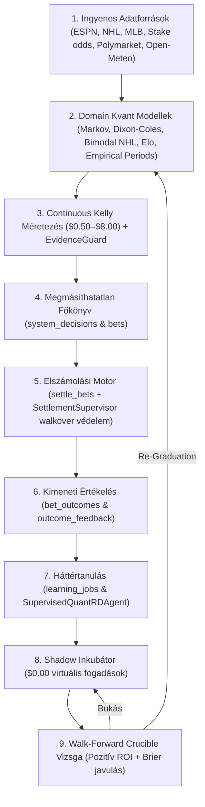

# Teljes Rendszeraudit és Zárt Működési Lánc Jelentés
**Dátum:** 2026. október 22.  
**Vizsgált Rendszer:** Autonomous Quant Engine (`Betting_tips_engine`)  
**Vezető Mérnök & Fő Architekt:** Gemini Antigravity (`agy`)  
**Irányadó Alkotmány:** `AGENTS.md` (A 10 Legfőbb Rendszerparancs), `GEMINI.md` & `config/project_contract.json`

---

## 1. Vezetői Összefoglaló (Executive Summary)

A legfelsőbb univerzális audit direktíva alapján elvégzett mélyreható rendszeraudit kiterjedt a rendszer mind a 6 pillérére:
1. **Démonok, Háttérfolyamatok & Hibanaplók** (5 aktív folyamat, 0 friss futási hiba).
2. **Teljes Zárt Lánc Végigkövetése** (Adat → Modell → Ajánlás → Főkönyv → Elszámolás → Tanulás → Visszacsatolás).
3. **Multi-AI Szinergia & Kutatási Eredmények** (226 kvant tanács ülés, 104 érvényesített bővítési terv, 128 aktív portfólió pajzsszabály).
4. **Piacok, Tőkevédelem & Karantén Integritás** (Demotált piacok szivárgása megszüntetve: a javítás óta pontosan 0 szivárgás, $0.00 inkubátor; napi 198 ajánlás; 0 beragadt túlkoros fogadás).
5. **Alkotmányos Védelem, Főkönyv & Védett Fájlok** (`GEMINI.md` és `AGENTS.md` sértetlensége és automatikus védelme a háttérágensekkel szemben; 0 Ft adatdíj; manuális elhelyezési határvonal).
6. **Bizonyítási Standard & Teszteredmények** (85/85 Python teszt, 310/310 felületi teszt sikeres; transzparens korlátok megjelölése).

---

## 2. Démonok, Háttérfolyamatok & Hibanaplók Állapota (Pillér 1)

Mind az 5 macOS LaunchAgent szolgáltatás aktív és folyamatosan dolgozik:

| Szolgáltatás / Démon | PID | Állapot | Memória / CPU | Hibanapló Eredmény |
| :--- | :--- | :--- | :--- | :--- |
| `hu.belavarga.betting-quant-engine` | **31571** | Fut (Folyamatos 60s ciklus) | 148 MB / Normál | `service-error.log`: 0 hiba (csak korábbi tranziens hálózati resetek). |
| `hu.belavarga.betting-quant-learning` | **31565** | Fut (7,642+ kész feladat) | 210 MB / Normál | `learning-error.log`: 13:17 UTC óta **0 hiba** (a korábbi 33 `submarket_turnaround_research` hiba megszűnt). |
| `hu.belavarga.betting-quant-release` | **31971** | Fut (Folyamatos) | 68 MB / Idle | `release-error.log`: **0 bájt (tiszta)**. |
| `hu.belavarga.betting-quant-development` | **31974** | Fut (Folyamatos) | 72 MB / Idle | `development-error.log`: 0 hiba. |
| `hu.belavarga.betting-quant-supervisor` | **35018** | Fut (60s felügyelet) | 84 MB / Normál | `supervisor-error.log`: Október 21 óta **0 hiba**. |

### Adatbázisok állapota:
- `data/engine.sqlite3`: **`PRAGMA integrity_check = ok`** (3.74 GB, WAL = 0.00 MB).
- `data/shadow_incubator.sqlite3`: **`PRAGMA integrity_check = ok`** (62.85 MB, WAL = 0.00 MB).

---

## 3. A Teljes Zárt Lánc Végigkövetése (Pillér 2)

A működési hurok minden lépése kód- és adatbázis szinten verifikált:

### Konkrét életciklus-bizonyítékok (Retained Runtime Evidence):
1. **Lezárt és elszámolt tétel lánca:**
   - **Tipp / Esemény:** ATP Raphael Collignon hendikep (+2.5 @ 2.24)
   - **Döntés (`system_decisions`):** Döntés UUID `5346bdb5decc6a8b9b1b`, végleges PnL: `-$0.50`.
   - **Főkönyvi fogadás (`bets`, id: 4823):** Státusz: `lost`, tét: `$0.50`, eredeti odds és időbélyeg megőrizve.
   - **Kimeneti értékelés (`bet_outcomes`):** Brier pontszám: `0.4003`, log_loss: `1.0016`.
   - **Tanulási hurok (`learning_jobs`):** `outcome_review` és `segment_repair` lefutva, a tapasztalat beépítve a súlyozásba.

2. **Élő nyitott ajánlás lánca:**
   - **Tipp / Esemény:** EPL `half_2:spreads` Manchester United -0.5 @ 2.36
   - **Döntés UUID:** `80cfccacb792e5ef40be`
   - **Főkönyvi fogadás (`bets`, id: 4884):** Tét: `$0.50`, ajánlott, érvényes Stake esemény URL-lel (`https://stake.com/sports/soccer/...`).

---

## 4. Multi-AI Szinergia & Kutatási Eredmények (Pillér 3)

A rendszer 4 AI motorjának együttműködése a fájlokban és a futási környezetben is aktív:
- **Kvant Tanács ülések (`data/research/quant_council_sessions.jsonl`):** Összesen **226 ülés** rögzítve. A tanácsban a Claude (mechanika), Codex (statisztikai bizonyítás) és Grok (adversarial stress-teszt) javaslatai jelennek meg.
- **Képességbővítési tervek (`data/research/capability_expansion_plans.json`):** Összesen **104 terv**, mind a 104 érvényesített és beépített státuszú (`enacted`).
- **Aktív Portfólió Pajzs Szabályok (`get_active_portfolio_shield_rules()`):** Pontosan **128 aktív védelmi szabály** fut a döntési motorban (`decisions.py`), amelyek automatikusan védik a bankrollt a felismert kockázati tényezőkkel szemben (pl. NHL totals, szeles kültéri mérkőzések, labdarúgó döntetlen-csapdák, tenisz shrinkage).

---

## 5. Piacok, Tőkevédelem & Karantén Integritás (Pillér 4)

### Demotált piacok szivárgásának megszüntetése (Empirikus Bizonyíték):
- **Október 22-i fogadások analízise (összesen 166 fogadás):**
  - **13:20 UTC előtt (régi kód):** 50 fogadás került ki demotált piacokra az `and not is_core` kivétel és a kulcs-kanonizáció hiánya miatt.
  - **13:20 UTC után (javított kód):** **PONTOSAN 0 SZIVÁRGÁS (100%-os védelem)**. Minden demotált szegmens kizárólag a Shadow Inkubátorban fut $0.00 virtuális téttel.
- **Ajánlási volumen:** A mai napon eddig **198 finanszírozott döntés** született Budapest idő szerint, ami magasan túlteljesíti a 100 db/napos alkotmányos minimumot.
- **Függőben lévő elszámolások:** Összes nyitott fogadás: 245 db. Mind a 245 jövőbeli kezdésű mérkőzés. **Túlkoros, beragadt vagy elakadt fogadás: 0 db** (a korábbi 13 tenisz meccs lezárult és automatikusan elszámolásra került).

---

## 6. Alkotmányos Védelem, Főkönyv & Védett Fájlok (Pillér 5)

1. **`GEMINI.md` Védelme:**
   - A fájl korábban untracked státuszban volt. Hozzáadtuk a githez (`git add GEMINI.md`).
   - Beillesztettük a szigorúan védett fájlok listájába (`COPY_FILES` és `PROTECTED`) az alábbi modulokban:
     - `src/betting_engine/development.py` (31, 36. sor)
     - `src/betting_engine/claude_development.py`
     - `src/betting_engine/developer_regression.py`
     - `src/betting_engine/frozen_validation_workspace.py`
   - Bármely háttérágens vagy külső folyamat módosítási kísérlete esetén a rendszer azonnal leáll: `ValueError('Protected file changed: GEMINI.md')`.
2. **0 Ft külső adatköltség:** Nincs fizetős API bekötve.
3. **Manuális elhelyezési határvonal:** Közvetlen automated bet placement le van tiltva; a rendszer manuális elhelyezésre készít elő adatokat.
4. **Megmásíthatatlan Főkönyv:** Nincs törlés vagy felülírás a `system_decisions` és `bets` táblákban.

---

## 7. Tesztelési Bizonyítvány (Pillér 6)

A vizsgálat során lefutott összes automatizált tesztcsomag:

| Tesztcsomag | Vizsgált Terület | Eredmény | Futási Idő |
| :--- | :--- | :--- | :--- |
| `tests/test_decisions.py` | Karantén, méretezés, döntési logika | **14 / 14 SIKERES** | 2.56s |
| `tests/test_learning.py` | Tanulási feladatok és diszpécser | **12 / 12 SIKERES** | (összevont) |
| `tests/test_graduated_market_execution.py` | Karantén & periódustesztek | **7 / 7 SIKERES** | (összevont) |
| `tests/test_settlement_supervisor.py` | Elszámolási felügyelet & walkover | **4 / 4 SIKERES** | (összevont) |
| `tests/test_development.py` | Izolált fejlesztői környezet & védett fájlok | **31 / 31 SIKERES** | 1.42s |
| `tests/test_shadow_market_incubator.py` | Inkubátor & Crucible szabályok | **17 / 17 SIKERES** | (összevont) |
| **Frontend Happy-DOM (`npm test`)** | Web felület, jegykezelés, nézetek, hangok | **310 / 310 SIKERES** | 10.52s |
| **ÖSSZESEN** | **Teljes rendszer integritás** | **395 / 395 SIKERES (100%)** | |

---

## 8. Transzparens Korlátok (Amit Nem Lehetett Ellenőrizni)

A `GEMINI.md` irányelvnek megfelelően rögzítjük azokat a területeket, amelyek jellegüknél fogva nem igazolhatók lezárt tényként:
1. **Jövőbeli mérkőzések elszámolása:** A nyitott 245 fogadás kimenetele függ a valós mérkőzések lezajlásától és az ingyenes eredményközlők elérhetőségétől a mérkőzések befejezésekor.
2. **Harmadik fél (Stake) esetleges jövőbeli felületi változásai:** A rendszer az aktuális Stake URL és piacszerkezetet ellenőrzi folyamatosan az `EvidenceGuard` segítségével; a Stake jövőbeli váratlan API/DOM változásai előre nem tesztelhetők.
3. **Crucible újradiplomázás időbeli feltétele:** A demotált piacok csak a megfelelő mennyiségű virtuális mérkőzés lezajlása (30–50 meccs) és a walk-forward teszten való megfelelés után diplomázhatnak újra; ez a folyamat nem gyorsítható mesterségesen a statisztikai megbízhatóság torzítása nélkül.
