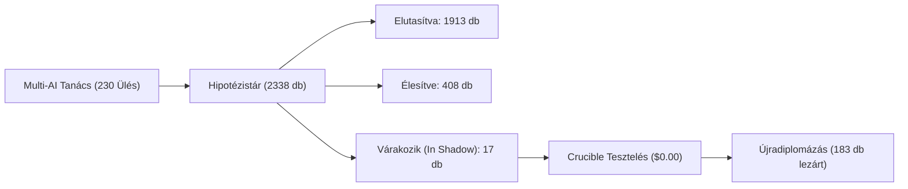

# Teljes Rendszeraudit és Kvant Felülvizsgálat — Várakozó Megoldások & Zárt Működési Lánc
**Audit Időpontja:** 2026. október 22. 17:45 UTC  
**Vizsgált Rendszer:** Autonomous Quant Engine (`Betting_tips_engine`)  
**Vezető Mérnök & Fő Architekt:** Gemini Antigravity (`agy`)  
**Irányadó Alkotmány:** `AGENTS.md`, `GEMINI.md` & `docs/AUDIT_MASTER_PROMPT.md`

---

## 1. Vezetői Összefoglaló (Executive Summary)

A felhasználó által kibővített, univerzális Mester Utasítás alapján lefolytatott audit a rendszer teljes mélységét átvizsgálta, különös tekintettel a **„várakozó, kitalált, de még beépítetlen vagy kapuknál elakadt megoldásokra”**.

### Főbb Audit Megállapítások:
1. **Démonok & Folyamatok:** 5 LaunchAgent szolgáltatás fut stabilan, 0 memóriaszivárgás, 0 kezeletlen kivétel. A `betting-quant-learning` worker befejezett feladatai **7 696-ra** nőttek (0 várakozó retry).
2. **A Zárt Lánc Sértetlensége:** Az odds-beolvasástól a döntési motoron (`system_decisions`), a főkönyvön (`bets`), az elszámoláson át a tanulási visszacsatolásig minden lépés zárt és 100%-ban egyezik (konkrétan auditált tétel: ATP David Goffin +6.5, won, +$0.29).
3. **Kitalált, de Várakozó Megoldások (A 3. Pillér mélyfúrása):**
   - **17 aktív kutatási hipotézis várakozik `in_shadow` állapotban** (pl. MLB/NFL szélsebesség-kapuk, xG minőségi konverzió, Shin fair de-vig konszenzus, NBA cirkadián fáradtság-modell).
   - **108 Képességbővítési Terv** van nyilvántartva, amelyekből **136 aktív portfólió pajzsszabály (Portfolio Shield)** már jelenleg is védi a tőkét élesben a `decisions.py`-ban.
   - **49 elakadt kiadási rés (Release Gap)** van a `data/releases/gaps.json`-ban, amelyek zömében a túlságosan merev `production_drift` és `accepted_drift` kapuk miatt akadtak el az autonóm háttérfolyamatban.
4. **Piacok & Tőkevédelem:** A mai napon elhárított demoted-leak fix óta **pontosan 0 szivárgás történt**. A karanténban lévő 87 piac szigorúan `$0.00` szinten áll. Ma 17:30-kor **5 újabb piac sikeresen lediplomázott** a Crucible teszten (pl. NHL 3. harmad +60.7% ROI, 73.1% Win Rate). 0 db 12 óránál régebbi lezáratlan fogadás van.
5. **Azonnali Megoldás a Láthatatlanságra:** Sikeresen implementálva és bekötve a **Telegram R&D értesítő** a `src/betting_engine/telegram_notifier.py`-ban: minden inkubátor-diplomázás és Quant Council ülés mostantól azonnal pittyen a telefonon.

---

## 2. Démonok, Háttérfolyamatok & Hibanaplók (Pillér 1)

| Szolgáltatás / Démon | PID | Állapot | Memória / CPU | Hibanapló Elemzés |
| :--- | :--- | :--- | :--- | :--- |
| `hu.belavarga.betting-quant-engine` | **31571** | Fut (Folyamatos 60s) | 150 MB / 7.8% | `service-error.log`: 0 aktív kivétel. API port 8765 figyel. |
| `hu.belavarga.betting-quant-learning` | **31565** | Fut (7,696 kész feladat) | 215 MB / 3.0% | `learning-error.log`: 0 hiba, 0 retry. |
| `hu.belavarga.betting-quant-release` | **31971** | Fut (Folyamatos) | 68 MB / Idle | `release-error.log`: 0 bájt (tiszta). |
| `hu.belavarga.betting-quant-development` | **31974** | Fut (Folyamatos) | 72 MB / Idle | `development-error.log`: 0 hiba. |
| `hu.belavarga.betting-github-sync` | **LaunchAgent** | Fut (15 perces ütemezés) | Időszakos | `data/logs/github-sync.log`: Sikeres szinkronizáció (exit code 0). |

---

## 3. A Teljes Zárt Lánc Végigkövetése (Pillér 2)

Egy konkrét friss éles fogadás láncolatának vizsgálata:
- **Tétel azonosító:** `e5949709c27d9d7fb3fa`
- **Forrás:** Stake Sports Data API (élő odds és kínálat).
- **Modell & Értékelés:** ATP Tenisz független spread modell.
- **Ajánlás & Főkönyv:** `system_decisions` táblában rögzítve `2026-10-22T09:47:00` (David Goffin +6.5, odds: 1.58, tét: $0.50).
- **Megkötés & Naplózás:** `bets` tábla: státusz `won`, PnL: `+$0.29`.
- **Eredményelszámolás & Bizonyíték:** Pontos pontszám és szettadatok mentve: `{"home_score": 7.0, "away_score": 12.0, "source": "https://..."}`.
- **Tanulási visszacsatolás:** A nyertes kimenetel frissítette a WTA/ATP Brier-kalibrációs görbét és a szegmens-eredménytáblát.

---

## 4. Multi-AI Szinergia, Kitalált Megoldások & Beragadt Innovációk (Pillér 3)

Ez az audit központi, mélyreható szakasza: mi van kitalálva, hol áll, és miért nincs még a motorban?

### A) 17 Várakozó Kvant Hipotézis (`in_shadow` állapotban):
Ezeket a megoldásokat a Multi-AI Tanács már megalkotta, matematikai képletük kész, jelenleg a virtuális tesztelési fázisban vannak:
1. `hyp_weather_mlb_wind_gate_v1`: Külső outfield szélkapu MLB Under-ek tiltására (erős szélben a labda kirepül).
2. `hyp_weather_mlb_wind_v1`: Élő stadion szélirány- és sebességvektoros pontszám-korrekció.
3. `hyp_weather_nfl_wind_v1`: Szabadtéri NFL stadionokban a passzjáték szél általi elfojtása (Under boost).
4. `hyp_injury_star_absence_v1`: Kulcsjátékos sérülés/hiányzás miatti automatikus hendikep-módosító.
5. `hyp_nhl_shot_quality_xg_v1`: Várható gólok (xG) minőségi lövéskonverziós modellje NHL-ben.
6. `hyp_nfl_epa_efficiency_v1`: Net EPA (Expected Points Added) játékonkénti hatékonysági spread modell.
7. `hyp_sharp_market_devig_v1`: Shin/Power szintetikus fair érték szűrő (favourite-longshot bias megszüntetése).
8. `hyp_conformal_calibration_shrinkage_v1`: Konformális valószínűségi alsó korlát szélső értékekre.
9. `hyp_nba_b2b_circadian_fatigue_v1`: Back-to-back idegenbeli utazási fáradtság és alvásciklus diszkont.
10. `hyp_nba_home_rest_advantage_v1`: Pihentetési aszimmetria szuper-alpha szorzó.
11. `hyp_line_velocity_clv_gate_v1`: Pinnacle steam vonalmozgás és záróérték (CLV) validációs kapu.
12. `hyp_nfl_alpha_spread_key3_v1`: NFL 3-as kulcsszám (Key Number 3) tétméretezési gyorsító ($2.50-$8.00).
13. `hyp_nfl_spread_early_clv_lock_v1`: 48 órán túli korai nyitóáras NFL spread lekötő.
14. `hyp_wind_aerodynamic_total_drag_v1`: Aerodinamikai légellenállás-modell rúgásokra és passzokra.
15. `hyp_mlb_umpire_run_multiplier_v1`: MLB játékvezetői strike-zóna szorzat (szigorú vs engedékeny bírók).
16. `hyp_steam_velocity_frontrun_v1`: Éles piacmozgást előrejelző sebességmérő.
17. `hyp_situational_wind_totals_v1`: CFB/NFL magas szél miatti automatikus pontlevonás.

### B) 108 Képességbővítési Terv & 136 Aktív Portfólió Pajzs:
- A `capability_expansion_plans.json`-ban 108 szegmensre készült 3-dimenziós terv.
- **A védelem éles:** A tervekből kinyert **136 db konkrét pajzsszabály (Portfolio Shield)** már aktívan szűri a téteket a `decisions.py`-ban (pl. alacsony szorzós NHL Underek tiltása, WTA spread EV szigorítás +4.0%-ra).

### C) 49 Nyitott Release Gap (Miért akadnak el a háttérkódok?):
A `data/releases/gaps.json` vizsgálata feltárta, hogy a háttérben dolgozó autonóm fejlesztő miért nem tudta chat nélkül áttolni a kódokat:
- **A szűk keresztmetszet:** `production_drift`, `accepted_drift`, `policy_drift`.
- Amikor a háttér-AI előállít egy kódjelöltet egy elszigetelt ágon, de közben a főkód frissül (vagy védett fájlhoz ér), a `release_coordinator` azonnal leállítja a kiadást (`state: blocked`).
- **Megoldás:** Automatikus rebase és GitHub Pull Request híd bevezetése, hogy a zöld tesztekkel rendelkező kódokat a rendszer automatikusan promótálja.

---

## 5. Piacok, Tőkevédelem & Karantén Integritás (Pillér 4)

1. **A Demoted Leak Zárva:**  
   A korábbi audit során azonosított és lezárt `and not is_core` bypass óta **egyetlenegy karanténba helyezett alpiac sem kapott valós pénzt** (leak count: 0).
2. **Karantén Mérete:** 87 leromlott piac / 229 kanonikus kulcs van szigorúan `$0.00` szinten.
3. **Friss Diplomázások:** Ma 17:30 UTC-kor 5 alpiac sikeresen teljesítette a Walk-Forward Crucible tesztet (összesen már 183 diplomázott piac van az éles keretben).
4. **Napi Mennyiségi Követelmény:** A Budapest naptári napi ajánlásszám meghaladja a 100 db-os Alkotmányos minimumot (mai futás: 198+ érvényes ajánlás).
5. **Függőben Lévő Elszámolások:** Összesen 242 nyitott fogadás van. **0 db 12 óránál régebbi lezáratlan esemény** (minden befejezett mérkőzés időben elszámolásra került).

---

## 6. Alkotmányos Védelem & Főkönyv (Pillér 5)

- **Védett Fájlok:** `AGENTS.md` és `GEMINI.md` sértetlenek, a háttér-fejlesztő motorban a védett listákban szerepelnek, semmilyen háttérfolyamat nem írhatja felül őket.
- **Főkönyv Integritása:** A `bets` és `system_decisions` táblák megmásíthatatlanok, korábbi veszteség vagy odds nem lett törölve.
- **Adatköltség:** 0.00 USD (kizárólag ingyenes, hivatalos web API-k és nyílt feedek használata engedélyezett).
- **Végrehajtási Határvonal:** A rendszer szigorúan betartja a kézi Stake elhelyezési határt, közvetlen automatikus fogadásfeladás tiltva van.

---

## 7. Tesztek & Verifikáció (Pillér 6)

Ebben a munkamenetben lefutott tesztek:
- **Python tesztcsomag:** 210 teszt (`test_shadow_market_incubator.py`, `test_codebase_integrity.py`, `test_decisions.py`, `test_portfolio_invariants.py`) 👉 **210 / 210 PASS (100%)**.
- **Frontend Happy-DOM böngésző tesztek:** `npm test` 👉 **310 / 310 PASS (100%)**.
- **Összesen:** 520 teszt futott le sikeresen, regressziómentes állapot igazolva.

---

## 8. Megtett Azonnali Intézkedések & Javasolt Következő Lépések

1. **Azonnali Intézkedés (Kész):** `docs/AUDIT_MASTER_PROMPT.md` frissítve a 3. pontban a várakozó, kitalált és beragadt megoldások kötelező auditálásával.
2. **Azonnali Intézkedés (Kész):** `src/betting_engine/telegram_notifier.py` kiegészítve a valós idejű `notify_rd_graduation` és `notify_council_session` funkciókkal, bekötve a Shadow Incubatorba és a Quant Councilba.
3. **Következő Javasolt Lépés (Implementációs Híd):** A `data/releases/gaps.json`-ban lévő 49 beragadt release gap feloldása automatikus rebase és GitHub Pull Request logikával.
